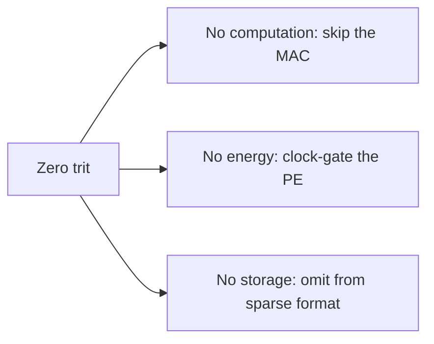
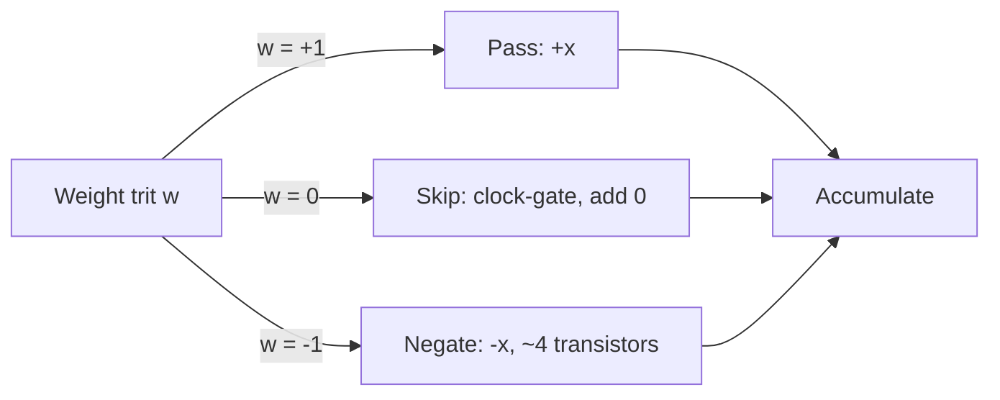
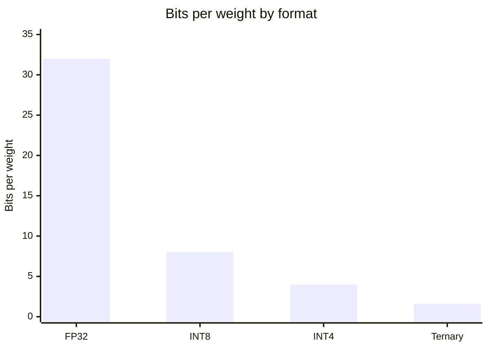
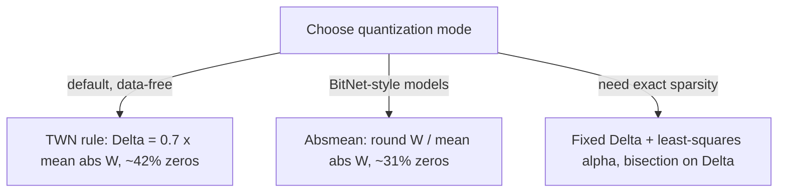
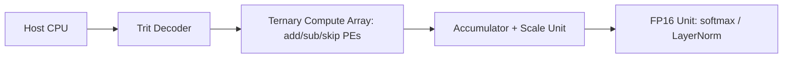
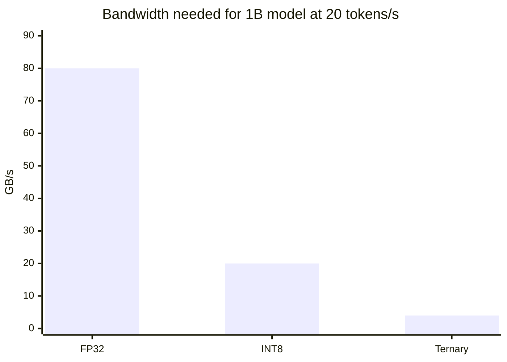
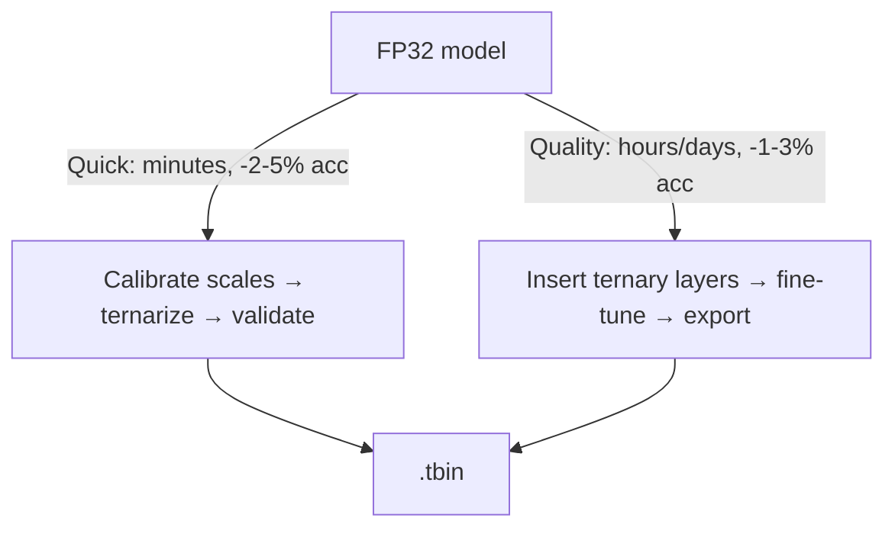

# Balanced Ternary for AI Computing

## What Is Balanced Ternary?

Most computers use **binary** — everything is 0 or 1. Balanced ternary uses **three** states:

| Value | Symbol | Meaning |
| ----- | ------ | ------- |
| -1    | T      | Negative |
| 0     | 0      | Zero |
| +1    | 1      | Positive |

That's it. Three simple values. But this small change has profound implications for AI hardware.

### Why Three States Matter

In a binary neural network, every weight is either `-1` or `+1`. There's no option for "unimportant." Every single weight must participate in computation — even the ones that are nearly zero.

Balanced ternary adds the **zero** state, which acts as a built-in pruning mechanism:

```
Binary:   {-1, +1}     → every weight contributes
Ternary:  {-1, 0, +1}  → near-zero weights become "skip"
```

The zero state means:
- **No computation**: skip the multiply-accumulate entirely
- **No energy**: clock-gate that processing element
- **No storage**: sparse formats can omit zeros

This is the single most important advantage of balanced ternary: **it turns pruning into a natural byproduct of quantization**.



---

## Why AI Is a Good Fit

### Multiplication Becomes Selection

Neural networks are mostly multiply-accumulate (MAC). With ternary weights, `w × x` never needs a multiplier:

| Weight | Result | What Hardware Does |
| ------ | ------ | ------------------ |
| +1     | x      | Pass through (wire) |
| 0      | 0      | Skip (clock gate) |
| -1     | -x     | Negate (~4 transistors) |

```
Inputs:   [4, 7, 2, 5]
Weights:  [1, T, 0, 1]        (T = −1)

select:   [+4, −7, skip, +5]  →  4 − 7 + 5 = 2   (zero multiplications)
```

At realistic sparsity this is 2–4× fewer operations than dense computation — and the multiplier (the most expensive unit on the chip) disappears entirely.



→ Deep dive: [Multiplication Becomes Selection](details/18-multiplication-as-selection.md) — MAC cost model, datapath design, op-count formulas, Elixir simulation.

---

## Storage: 20× Smaller Models

A ternary weight carries `log₂(3) ≈ 1.585` bits vs 32 bits for FP32:

| Format | Bits/Weight | 1B Parameters |
|--------|-------------|---------------|
| FP32   | 32          | 4 GB          |
| INT8   | 8           | 1 GB          |
| Ternary| ~1.585      | ~200 MB       |

A 200 MB model fits in **on-chip SRAM** — no DRAM stream needed. Packing schemes:



Packing schemes:

| Scheme | Trits → Bits | Efficiency | Best For |
|--------|--------------|------------|----------|
| 5→8    | 5 → 8        | 95%        | Simple hardware decode |
| 10→16  | 10 → 16      | 90%        | Maximum storage density (.tbin default) |
| 20→32  | 20 → 32      | 81%        | SIMD-friendly access |

→ Deep dive: [Storage Format](details/04-storage-format.md) · [Sparsity Economics](details/19-sparsity-economics.md)

---

## Sparsity: The Hidden Superpower

Ternary doesn't just quantize — it **combines quantization and pruning into one step**. The first half of the zeros are nearly free:

| Sparsity | Accuracy Impact | Compute Reduction |
|----------|-----------------|-------------------|
| ~31–42% (default modes) | ≈ free | 1.4–1.7× |
| 50%       | +1.1 PPL | 2× |
| 75%       | +4.0 PPL | 4× |
| 90%       | +8.5 PPL | 10× |

Zeros only pay off when hardware can *detect* them instantly, *gate* lanes, and *omit* them from memory traffic.

→ Deep dive: [Sparsity Economics](details/19-sparsity-economics.md) — where zeros come from, savings models, sparse formats, hardware requirements.

---

## Scale Factors & Quantization Theory

Pure `{-1, 0, +1}` is too lossy; each output channel gets an FP16 scale α (`W_eff = α ⊙ T`). Choosing the threshold Δ is a solved problem with three proven rules — all implemented in the tool:

| Rule | Effective Δ | Zero fraction | Notes |
|------|-------------|---------------|-------|
| TWN rule (default) | 0.7·mean\|W\| | ~42% | data-free joint optimum (Li & Liu, 2016) |
| Absmean / BitNet b1.58 | round(W / mean\|W\|) | ~31% | no search; field-proven at B-scale (Ma et al., 2024) |
| Fixed Δ + least-squares α | user-set | tunable | full control; exact sparsity via bisection |

Measured cross-check (toolchain, Gaussian weights): absmean → 31.03% zeros, TWN → 42.4% — matching theory.



→ Deep dive: [Quantization Theory](details/20-quantization-theory.md) — derivations, SQNR analysis, bisection proof, mode-to-flag mapping.

---

## Hardware Architecture

A ternary accelerator pipeline:



Each processing element is just pass/negate/skip — no multiplier, no FP unit. Three states live on two wires per trit (**differential encoding**): negation is a wire swap, zero detection is one NOR gate.

Hybrid precision keeps what works: ternary GEMM (~90% of compute), INT8 activations, FP16 for softmax/LayerNorm/attention scores.

→ Deep dives: [Architecture Overview](details/01-architecture-overview.md) · [Hardware Architecture](details/05-hardware-architecture.md) · [Differential Encoding](details/09-differential-encoding.md)

---

## Why This Targets the Real Bottleneck

LLM decode is **memory-bandwidth-bound**: at batch 1, arithmetic intensity is fixed at `16/bits` FLOP per byte regardless of model size. Time-per-token is set by bytes moved:

```
FP32:    4 GB   × 20 tokens/s = 80 GB/s needed
Ternary: 200 MB × 20 tokens/s = 4 GB/s needed      (20× less; SRAM-resident → ~0)
```

Energy follows: weight fetch drops from ~60% of inference energy to ~0%, compute to ~8%.



→ Deep dive: [Memory Bandwidth Analysis](details/21-memory-bandwidth-analysis.md) — roofline arithmetic, KV cache corrections, batch effects, energy breakdown.

---

## Running on Today's Hardware

Purpose-built accelerators don't exist yet, but the storage/bandwidth win lands today:

- **GPUs**: packed trits decoded on-device → tensor cores ([CUDA/MLX example](examples/ternary_accel/))
- **CPUs**: AMX/NEON dot products on unpacked weights
- **NPUs/FPGAs**: convert or implement native add/sub/skip datapath

See [Running on Current Hardware](details/11-current-hardware-gpu-cpu-npu.md).

For maximum efficiency, a purpose-built ASIC reaches ~50K tokens/s (1B model) at ~5 W in 20 mm².

→ Deep dives: [Custom Accelerator Design](details/12-custom-ternary-accelerator-design.md) · [FPGA Experiment Guide](details/16-fpga-experiment-guide.md) · [ASIC Implementation](details/17-asic-implementation-guide.md)

---

## Converting Models to Ternary

Two paths:



A complete pure-Elixir toolkit ships in [`tools/ternary_converter/`](tools/ternary_converter/):

```bash
# Real HuggingFace checkpoints → .tbin (no Python required)
mix run -e 'TernaryConverter.CLI.main(["convert",
  "--input", "model.safetensors", "--arch", "llama", "--mode", "absmean"])'

mix run -e 'TernaryConverter.CLI.main(["info", "--model", "model.tbin"])'
mix run -e 'TernaryConverter.CLI.main(["validate", "--model", "model.tbin"])'
```

- Per-architecture mixed-precision policies: `llama` / `gpt2` / `bert` / `vit` / `generic`
- Quantization modes: `twn` / `absmean` / `delta` (+ exact target-sparsity bisection)
- Sensitive layers (embeddings, norms, LM head) preserved as FP16 records

→ Deep dive: [Model Conversion Guide](details/13-model-conversion-guide.md). Run converted weights on GPU via [`examples/ternary_accel/`](examples/ternary_accel/).

---

## Comparison with Other Approaches

| Approach | Bits/Weight | Multiplier? | Sparsity? | Accuracy | Hardware |
|----------|-------------|-------------|-----------|----------|----------|
| **Ternary (PTQ)** | **1.585** | **No** | **Natural** | **−1–3%** | Custom |
| Ternary (trained, BitNet b1.58) | 1.585 | No | Natural | −2–4% vs FP16 LLaMA | Shipped |
| Binary | 1 | No | No | −5–10% | FPGA |
| INT8 | 8 | Yes | Structured | −0.5% | GPU/NPU |
| INT4 | 4 | Yes | No | −1% | GPU |
| FP8 | 8 | Yes | No | −0.1% | GPU |
| FP32 | 32 | Yes | No | Baseline | GPU |

**Ternary's unique combination**: lowest bit width + no multiplier + natural sparsity.

→ Deep dive: [Detailed Comparison](details/10-comparison.md)

---

## Long-Term Vision

Balanced ternary computing was explored in the 1950s (the Soviet Setun computer) but lost to binary manufacturing economics. AI changes the calculus: neural networks are error-tolerant, memory-bound, multiplication-heavy, and naturally sparse — the first workload whose statistics make three states cheaper per unit of useful work.

The realistic vision is not replacing binary but a **specialized inference substrate**: ternary weights resident in on-chip SRAM, processed by multiplier-free arrays, serving edge AI.

→ Deep dive: [History and Long-Term Vision](details/22-history-and-vision.md) — Setun, why binary won, target markets, phase gates, honest risks.

---

## Document Structure

### Concept (this file)
High-level overview and motivation — every section above links to its deep dive.

### Deep Dives

| Document | Content |
|----------|---------|
| [`01-architecture-overview`](details/01-architecture-overview.md) | Layer types, data flow, hybrid precision, scaling strategies |
| [`02-weight-quantization`](details/02-weight-quantization.md) | Quantizer pipeline, threshold methods, clipping, sensitivity, QAT |
| [`03-training`](details/03-training.md) | Training pipeline, STE variants, distillation, distributed training |
| [`04-storage-format`](details/04-storage-format.md) | Packing schemes, sparse formats, decoder design, bandwidth calc |
| [`05-hardware-architecture`](details/05-hardware-architecture.md) | PE design, systolic array, memory hierarchy, ISA, verification |
| [`06-llm-inference-engine`](details/06-llm-inference-engine.md) | Transformer mapping, KV cache, throughput analysis, energy |
| [`07-accuracy-analysis`](details/07-accuracy-analysis.md) | Benchmarks, sensitivity analysis, ablation studies |
| [`08-research-roadmap`](details/08-research-roadmap.md) | 48-week plan, resources, risks, publication strategy |
| [`09-differential-encoding`](details/09-differential-encoding.md) | Two-wire encoding, CMOS compatibility, DFT |
| [`10-comparison`](details/10-comparison.md) | Detailed comparison with BNN, INT8, INT4, FP8, pruning |
| [`11-current-hardware`](details/11-current-hardware-gpu-cpu-npu.md) | GPU/CPU/NPU/FPGA deployment today |
| [`12-custom-accelerator`](details/12-custom-ternary-accelerator-design.md) | Full ASIC architecture specification |
| [`13-model-conversion`](details/13-model-conversion-guide.md) | PTQ/QAT pipelines, recipes, Elixir toolchain |
| [`14-ternary-llm-feasibility`](details/14-ternary-llm-feasibility.md) | Feasibility at trillion-parameter scale, MoE, cost analysis |
| [`15-ternary-vision`](details/15-ternary-vision-computing.md) | Vision computing: CNNs, ViT, detection, segmentation |
| [`16-fpga-experiment`](details/16-fpga-experiment-guide.md) | FPGA experiment guide: board selection, RTL design, benchmarking |
| [`17-asic-implementation`](details/17-asic-implementation-guide.md) | ASIC implementation guide: RTL design, physical design, DFT, manufacturing |
| [`18-multiplication-as-selection`](details/18-multiplication-as-selection.md) | MAC cost model, select/add/skip datapath, op-count math, PE economics |
| [`19-sparsity-economics`](details/19-sparsity-economics.md) | Sources of zeros, savings models, sparse formats, hardware gating |
| [`20-quantization-theory`](details/20-quantization-theory.md) | Derivations: LS scales, TWN joint optimum, absmean, SQNR, bisection |
| [`21-memory-bandwidth-analysis`](details/21-memory-bandwidth-analysis.md) | Roofline at batch 1, SRAM fit, energy breakdown, batch effects |
| [`22-history-and-vision`](details/22-history-and-vision.md) | Setun history, binary's win, target markets, phase gates, risks |
| [`23-practical-labs-and-exam`](details/23-practical-labs-and-exam.md) | Study path, 5 hands-on labs, capstone exam with answer key and rubric |

### Code & Tools
| Path | Content |
|------|---------|
| [`tools/ternary_converter/`](tools/ternary_converter/) | Full Elixir app: convert (safetensors → .tbin), demo, info, validate |
| [`examples/ternary_pure/`](examples/ternary_pure/) | Pure Elixir quantization + packing demo |
| [`examples/ternary_nx/`](examples/ternary_nx/) | Nx tensor-based quantization + GEMM demo |
| [`examples/ternary_accel/`](examples/ternary_accel/) | Ternary GEMM on GPU: NVIDIA CUDA (EXLA) + Apple Silicon MLX (EMLX) |
