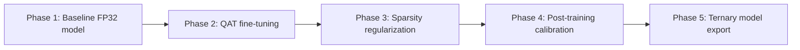
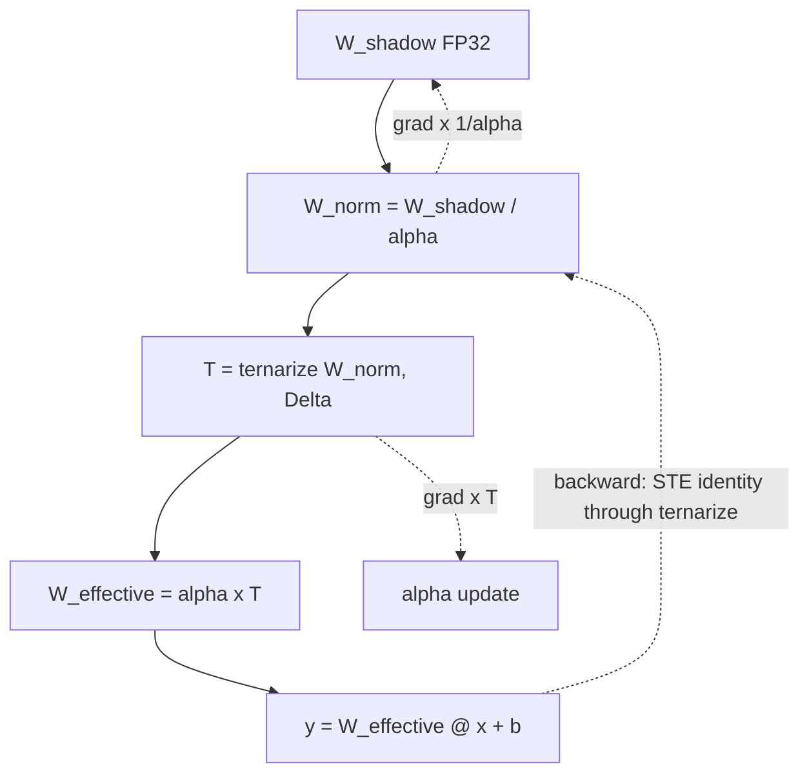
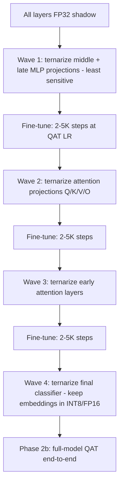
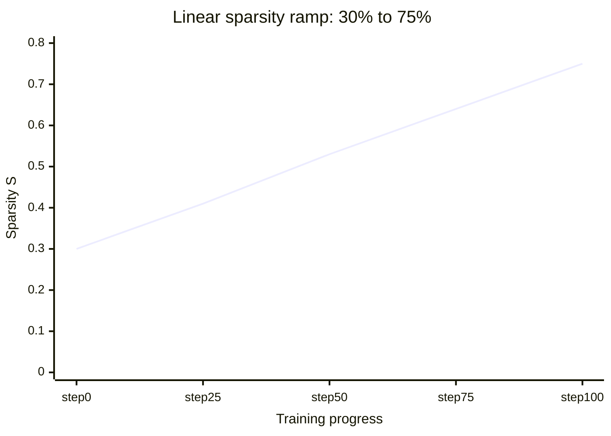
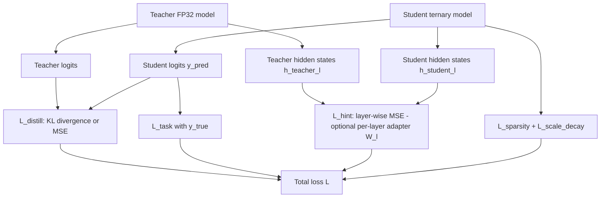
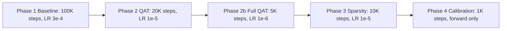

# 3. Training a Balanced-Ternary Neural Network

## 3.1 Training Pipeline Overview

```
Phase 1: Pre-train or load FP32 model
Phase 2: Quantization-aware fine-tuning
Phase 3: Sparsity regularization
Phase 4: Post-training calibration
Phase 5: Final ternary model export
```



---

## 3.2 Phase 1: Baseline Model

Start with a standard FP32 model. Options:

| Option | When to Choose |
|--------|---------------|
| Train from scratch | Novel architecture |
| Load pretrained model | Using existing model (LLaMA, GPT, etc.) |
| Knowledge distillation | Student gets teacher guidance |
| Continue pre-training | Domain adaptation |

The baseline should be as good as possible. Any existing accuracy gap will worsen after ternarization.

---

## 3.3 Phase 2: Quantization-Aware Training (QAT)

> This section expands on the QAT overview in §2.6 of [02-weight-quantization.md](02-weight-quantization.md).

### Forward Pass (Inference)

```
1. Retrieve shadow weight W_shadow (FP32)
2. Divide by per-channel scale α: W_norm = W_shadow / α
3. Ternarize: T = ternarize(W_norm, Δ)
4. Reconstruct: W_effective = α × T
5. Compute layer output: y = W_effective @ x + b
```

### Backward Pass

```
Gradient of ternarization is zero almost everywhere.
Solution: Straight-Through Estimator (STE).

∂L / ∂W_norm ≈ ∂L / ∂T   (identity mapping for gradient)

∂L / ∂W_shadow = ∂L / ∂T × (1/α)
∂L / ∂α = ∂L / ∂T × T
```



### Pseudocode

```python
def forward(self, x):
    W_norm = self.W_shadow / self.scale            # [out_dim, in_dim]
    T = self.ternarize(W_norm, self.delta)         # {-1,0,+1}
    W_effective = self.scale * T                    # [out_dim, in_dim]
    return F.linear(x, W_effective, self.bias)

def ternarize(W, delta):
    return torch.where(W > delta, 1.0,
           torch.where(W < -delta, -1.0, 0.0))

def backward_hook(grad):
    # STE: pass gradient through unchanged
    return grad
```

### Elixir (Nx): Ternary Linear Layer with QAT

```elixir
defmodule TernaryLayer do
  import Nx.Defn

  @doc """
  Ternarize a tensor: {-1, 0, +1} with threshold delta.
  Uses Nx for hardware-accelerated tensor ops.
  """
  defn ternarize(w, delta) do
    Nx.select(w > delta, 1.0,
      Nx.select(w < -delta, -1.0, 0.0))
  end

  @doc """
  Forward pass with Straight-Through Estimator.
  W_shadow: full-precision shadow weights (FP32)
  scale: per-channel scale factors
  x: input tensor
  """
  defn forward(w_shadow, scale, x, delta) do
    # Normalize weights
    w_norm = w_shadow / Nx.new_axis(scale, 1)

    # Ternarize
    t = ternarize(w_norm, delta)

    # Reconstruct effective weights
    w_effective = Nx.new_axis(scale, 1) * t

    # STE: pass gradient through unchanged
    w_ste = Nx.as_type(w_shadow, Nx.type(w_shadow)) +
            (w_effective - Nx.as_type(w_shadow, Nx.type(w_shadow)))
            |> Nx.as_type(Nx.type(w_shadow))

    Nx.dot(x, w_ste)
  end

  @doc """
  Sparsity regularization loss.
  Encourages weights toward zero by penalizing non-zero entries.
  """
  defn sparsity_loss(w, delta, lambda) do
    t = ternarize(w, delta)
    density = Nx.mean(Nx.abs(t))
    lambda * density
  end
end
```

### 3.3.1 Learning Rate Scheduling for QAT

QAT is significantly more sensitive to learning rate than standard fine-tuning. The discrete nature of ternarization means large gradient updates can cause weights to oscillate between quantization bins, destabilizing training. As a rule of thumb, **QAT requires a learning rate 10–100× lower** than the corresponding FP32 fine-tuning rate.

**Cosine annealing with warm restarts** works best for QAT. The smooth decay avoids sudden LR changes that can push weights across the ternarization threshold Δ in bulk, while periodic restarts help escape plateaus caused by the non-convex ternary loss landscape.

| Model Size | Fine-Tune LR | QAT LR (recommended) | Warm-up Steps | Restart Period |
|------------|-------------|----------------------|---------------|----------------|
| < 100M params | 1e-4 | 1e–5 – 1e-6 | 200 | 2K steps |
| 100M – 1B | 3e-5 | 3e-6 – 1e-6 | 500 | 5K steps |
| 1B – 10B | 1e-5 | 1e-6 – 5e-7 | 1K | 10K steps |
| > 10B | 5e-6 | 5e-7 – 1e-7 | 2K | 20K steps |

Key guidelines:
- **Always use warm-up** (linear or cosine) for at least the first 500–2000 steps. Jumping to the target LR immediately causes catastrophic weight re-assignment.
- **Restart period** should align with the Δ schedule: restart just before each Δ increase so the optimizer can re-stabilize.
- If loss spikes after a restart, reduce the peak LR by 2× and increase warm-up proportionally.

### 3.3.2 Gradient Flow in Detail

The QAT backward pass is worth writing out explicitly, because three different quantities receive gradients and each follows a different path through the quantizer.

Setup for one output channel `j` with weights `W_norm[j,:] = W_shadow[j,:] / αⱼ` and ternary output `T[j,:]`:

```
Forward:
    W_norm  = W_shadow / α          (elementwise, α broadcast per channel)
    T       = ternarize(W_norm, Δ)  (discrete: {-1, 0, +1})
    W_eff   = α × T
    y_j     = Σᵢ W_eff[j,i] × x_i + b_j

Backward (given ∂L/∂y from upstream):
    ∂L/∂b_j        = ∂L/∂y_j                                    (bias, exact)
    ∂L/∂α_j        = Σᵢ (∂L/∂y_j) × x_i × T[j,i]                (scale, exact given T)
    ∂L/∂W_eff[j,i] = (∂L/∂y_j) × x_i                            (exact)
    ∂L/∂T[j,i]     = α_j × (∂L/∂y_j) × x_i                      (exact given W_eff = α×T)
    ∂L/∂W_norm[j,i] ≈ ∂L/∂T[j,i]          ← THE STE APPROXIMATION (true gradient is 0 a.e.)
    ∂L/∂W_shadow[j,i] = ∂L/∂W_norm[j,i] / α_j                   (chain through normalization)
```

Where the approximation error lives: the true derivative of `ternarize` is zero except on the three measure-zero threshold surfaces `W_norm = ±Δ`. Every weight strictly inside the zero band `|W_norm| < Δ` therefore receives **no gradient from the quantizer itself** under exact differentiation — it would never move. STE substitutes `∂T/∂W_norm ≈ 1`, which means:

1. Weights inside the zero band still drift (they get gradient as if they contributed linearly). Drift is what allows a weight to eventually cross ±Δ and become ±1 — this is the mechanism QAT depends on.
2. The gradient magnitude for weights deep inside the band is *overestimated* (their true contribution to changing T is zero until they reach the boundary). This is benign — it biases shadow weights toward the decision boundaries and is one reason QAT tolerates higher noise than exact methods would suggest.
3. Only the *sign* of movement is informative for weights in the band; the magnitude is a heuristic. This is why STE variants (§3.4) that taper the gradient — clipped or hard-sigmoid — improve stability: they shrink the overestimate rather than changing its direction.

Two practical notes:

- **Gradient clipping is not optional.** Because STE injects gradients through a discontinuous function, occasional large gradient spikes occur exactly when many weights sit near ±Δ and cross simultaneously. Clip global gradient norm (e.g., to 1.0) and combine with the low learning rates of §3.3.1.
- **Scale gradients are exact, so α can use a larger LR than W_shadow.** Some implementations give α a 5–10× higher learning rate; since `∂L/∂α` passes through real multiplication (not STE), it is well-behaved. If scales oscillate, apply the same clipping rule instead of lowering the shared LR.

### 3.3.3 Shadow Weight Maintenance

The shadow weights are the only continuously trainable copy of the model, and their health determines whether ternarization stays stable. Three maintenance rules:

1. **Clamp after every optimizer step.** Keep normalized shadow weights bounded, e.g. `W_shadow ← clamp(W_shadow, -c·α, +c·α)` with `c ≈ 1` (aligning with clipped STE's `|W_norm| ≤ 1` support). Without clamping, gradient descent on shadow weights is unconstrained and can push weights arbitrarily far outside the ternarization decision region, where STE gradients become meaningless.
2. **Do not decay shadow weights toward zero with standard weight decay.** L2 decay on `W_shadow` is redundant with `L_sparsity` (§3.5) and double-counts: it shrinks weights that the Δ-threshold is already handling. Disable weight decay on shadow weights; keep it only on biases and any adapter parameters.
3. **Log per-layer ternary density every N steps.** Density = fraction of `|T| = 1`. Sudden density collapse (all-zero) or saturation (all-±1) are the leading indicators of the failure modes in §3.9 — both are visible in density long before they are visible in loss.

### 3.3.4 Progressive (Layer-Wise) QAT Rollout

Ternarizing every layer simultaneously on step one of Phase 2 maximizes the initial accuracy shock. The gentler and more effective schedule is **progressive rollout**: ternarize layers in order of increasing sensitivity, fine-tuning between waves, following the sensitivity ranking of §2.8 in [02-weight-quantization.md](02-weight-quantization.md).



Rules of thumb:

- **Each wave is a small accuracy shock** that the following fine-tune window absorbs; the cumulative shock is far smaller than all-at-once ternarization at the same total step budget.
- **Sensitive layers are ternarized last**, when all upstream layers have already adapted to producing ternary-friendly activations.
- **Embeddings stay in INT8/FP16 permanently** (per §2.8) — they are not part of any wave.
- If a wave's fine-tune fails to recover (validation loss stays above the pre-wave level + tolerance), the fallback is to leave that wave's layers in INT8 — this is exactly the manual version of the automatic mixed-precision search in §2.8.1.

This progressive schedule is what Phase 2 (layer-wise QAT) and Phase 2b (full QAT) of the §3.8 schedule implement: Phase 2 covers the waves, Phase 2b is the final end-to-end pass after the last wave.

---

## 3.4 Straight-Through Estimator Variants

| Variant | Description | Stability |
|---------|------------|-----------|
| Identity STE | ∂T/∂W = 1 in backward | Medium |
| Clipped STE | ∂T/∂W = 1 for |W_norm| ≤ 1, else 0 | Good |
| Hard sigmoid STE | ∂T/∂W = max(0, 1 − |W_norm|) | Best |

Recommended: **Clipped STE** for most applications.

### 3.4.1 Why the Variants Differ

The three variants answer one question differently: *how much gradient should a weight receive as a function of how far it sits from the quantization boundaries?*

- **Identity STE** gives every weight the same gradient regardless of position. Weights deep inside the zero band — nowhere near a boundary — receive full-strength gradients that overestimate their influence (§3.3.2), causing drift churn: weights wander without any near-term chance of changing their ternary value.
- **Clipped STE** zeroes the gradient for `|W_norm| > 1`. These weights can never change their ternary value anyway (they are pinned at ±1 for any Δ ≤ 1), so spending gradient on them is wasted and destabilizing — clipping redirects optimizer effort to weights near the boundaries, where it can actually flip a trit. This is why it is the recommended default.
- **Hard sigmoid STE** additionally tapers the gradient *inside* the band (`max(0, 1 − |W_norm|)`), giving weights near ±Δ a stronger pull than weights near 0. It is the most faithful approximation of "how likely is this weight to cross a boundary," and the most stable — at the cost of slightly slower drift for genuinely ambivalent mid-band weights. Use it when training is unstable with clipped STE, or for very deep networks where error compounding amplifies STE noise.

All three share the same forward pass; they differ only in the backward multiplier. Switching variants mid-training is therefore safe and occasionally useful (e.g., start with identity for fast early movement, switch to clipped once density stabilizes).

---

## 3.5 Phase 3: Sparsity Regularization

Encourage more weights to become 0 during training.

### L1 Regularization

```
L_sparsity = λ × |W_shadow / α|
```

This pushes small weights toward 0.

### Hard Threshold Decay

```
At epoch E:
    Δ = Δ_initial × (1 − E / total_epochs)

Or step schedule:
    Δ = step(E, [0, 10, 20], [0.3, 0.6, 1.0])
```

Gradually increasing `Δ` forces more weights to zero.

### Soft Sparsity Target

```
Target sparsity: S_target (e.g., 0.5 = 50%)

L_sparsity = λ × |sparsity(W_ternary) − S_target|
```

Train toward a specific sparsity level.

### Sparsity Schedule

Rather than targeting the final sparsity level from the start, it is better to **begin with low sparsity (e.g., 30%) and gradually increase to the target (e.g., 75%)** over the course of training. Starting with high sparsity from the beginning forces too many weights to zero prematurely, which can destroy useful representations and make recovery impossible. A linear or cosine ramp from the initial to the target sparsity over the full training duration gives the optimizer time to identify which weights are truly expendable before committing them to zero.

```
S_current = S_initial + (S_target − S_initial) × (step / total_steps)

Example schedule:
  Step 0      → S = 0.30
  Step 25%    → S = 0.41
  Step 50%    → S = 0.53
  Step 75%    → S = 0.64
  Step 100%   → S = 0.75
```



---

## 3.6 Phase 4: Post-Training Calibration

After QAT, freeze all weights (including T) and calibrate scales.

### Calibration Dataset

Use a small representative dataset (e.g., 512–4096 samples).

### Scale Optimization

For each layer:

```
Given:    T_ternary (fixed)
Given:    validation samples {x_i, y_i}
Optimize: α to minimize task loss

Method: grid search or gradient descent on α
```

### Bias Correction

After ternarization, the expected output distribution shifts:

```
E[FP32 output] — E[ternary output] ≠ 0
```

Fix: subtract the mean error per channel:

```
b_corrected = b + E[FP32 output] − E[ternary output]
```

---

## 3.7 Knowledge Distillation for Ternary Models

Training a ternary model from scratch is hard. Distillation helps significantly.

### Set-up

```
Teacher: FP32 model (or high-precision model)
Student: Ternary model (weights = {-1,0,+1})
```

### Loss Function

```
L = α × L_task(y_pred, y_true)
  + β × L_distill(y_pred, y_teacher)
  + γ × L_sparsity(W_ternary)
  + δ × L_scale_decay(α)
```

Where:

- `L_task`: standard task loss (cross-entropy, MSE, etc.)
- `L_distill`: KL divergence or MSE between student and teacher logits
- `L_sparsity`: regularization pushing weights toward 0
- `L_scale_decay`: weight decay on scale factors

Typical ratio: `α:β:γ:δ = 0.5:0.5:0.01:0.001`



### 3.7.1 Layer-Wise Distillation

Matching only the final output logits is often insufficient for ternary models, whose representational capacity is severely constrained. **Layer-wise distillation** — matching intermediate layer outputs between teacher and student — significantly improves ternary training by providing richer gradient signals at every depth.

The idea is to align the student's hidden representations with the teacher's at each corresponding layer (or at selected layers). This is done via a **hint loss**:

```
L_hint = Σ_l ||h_student_l − h_teacher_l||²
```

where `h_student_l` and `h_teacher_l` are the hidden states at layer `l` of the student and teacher respectively. If the teacher and student have different hidden dimensions, a small linear projection `W_l` is learned for each matched layer:

```
L_hint = Σ_l ||W_l × h_student_l − h_teacher_l||²
```

Practical tips:
- **Match every layer** for best results, or at minimum every 3–4 layers.
- Use a **separate linear adapter** per layer; sharing adapters across layers hurts performance.
- Weight deeper layers more heavily, as errors compound through the network.
- The total distillation loss becomes: `L_distill = β₁ × L_logit + β₂ × L_hint`, with `β₂ ≈ 0.1–0.5 × β₁`.

---

## 3.8 Training Schedule Example

### For a 1B parameter LLM

```
Phase 1 (Baseline):
    Steps: 100K
    Learning rate: 3e-4
    Precision: FP32/BF16
    Hardware: 8× GPU

Phase 2 (QAT):
    Steps: 20K
    Learning rate: 1e-5 (lower)
    Schedule: cosine decay
    Tricks: 
        - Clipped STE
        - Gradual Δ increase
        - Warm-up for 500 steps

Phase 2b (Full QAT):
    Steps: 5K
    Learning rate: 1e-6 (very low)
    Description: All layers ternarized simultaneously.
    Purpose: Fine-tune the fully-ternary model end-to-end
             after layer-wise QAT stabilizes individual layers.
    Tricks:
        - Very small LR to avoid destabilizing ternarized weights
        - Cosine decay from 1e-6 to 1e-7
        - No Δ increase (keep Δ fixed at final Phase 2 value)
        - Monitor per-layer density to ensure no catastrophic
          weight collapse

Phase 3 (Sparsity):
    Steps: 10K
    Learning rate: 1e-5
    λ_sparsity: 0.01 → 0.1 (increase slowly)

Phase 4 (Calibration):
    Steps: 1K (forward only)
    Dataset: 1024 validation examples
    Optimize: per-channel α
```



---

## 3.9 When Ternary Training Fails

Common failure modes and fixes:

| Symptom | Likely Cause | Fix |
|---------|-------------|-----|
| Accuracy drop > 10% | Δ too large | Reduce Δ, use per-channel scale |
| Model outputs NaN | Gradient explosion | Gradient clipping, lower lr |
| All weights become 0 | Δ too large, or lr too high | Lower Δ, reduce sparsity penalty |
| Only +1 and −1, no zeros | Δ too small, no sparsity | Increase Δ, add sparsity regularization |
| Training diverges | STE instability | Use clipped STE, reduce lr 10× |

---

## 3.10 Hardware-Aware Training

Simulate hardware constraints during training:

```
1. Pack ternary weights into 16-bit words
2. Simulate add/sub/skip compute
3. Model memory bandwidth savings
4. Account for zero-skip speedup

This gives realistic performance estimates.
```

### Training-Time Speed Simulation

Track:

```
Density: fraction of non-zero weights
Effective MACs: density × total_params
Skipped operations: 1 − density
```

End-to-end latency estimate:

```
Latency ≈ (effective_MACs × compute_time)
         + (non-zero_weight_transfer × bandwidth_time)
         + (activations × compute_time)
```

---

## 3.11 Recommended Training Framework

```
Software stack:

PyTorch 2.x      → training framework (with torch.compile)
TorchDistrib     → distributed training (FSDP/DeepSpeed)
Custom QAT       → ternary quantization layers
Triton kernels   → ternary GEMM simulation
HuggingFace      → model loading and tokenizer
WandB            → experiment tracking
```

### Minimum Viable Training Script

> See the complete `TernaryLinear` implementation with quantization and STE in §11.6.1 of [11-current-hardware-gpu-cpu-npu.md](11-current-hardware-gpu-cpu-npu.md).

---

## 3.12 Distributed Training Considerations

Ternary models can leverage standard distributed training techniques, but the ternary weight constraint introduces nuances that require special handling.

### Data Parallelism (Recommended)

Data parallelism works transparently with ternary training. Each device holds a full replica of the FP32 shadow weights and ternary weights, processes a different mini-batch, and gradients are all-reduced in FP32 before the optimizer step. No changes to the standard DDP/FSDP pipeline are required.

```
Standard DDP / FSDP:
  - Each rank: full copy of W_shadow (FP32) + T (ternary)
  - Gradients: FP32, all-reduced as usual
  - Optimizer step: updates W_shadow on each rank identically
  - Ternarization: re-applied locally after each update
```

**Memory note:** The FP32 shadow weights double the memory footprint compared to a pure ternary model. For very large models, consider keeping only the ternary weights in device memory and maintaining shadow weights in CPU memory (similar to CPU offloading in ZeRO-Infinity), updating them asynchronously.

### Model Parallelism (Requires Special Handling)

Model parallelism (tensor or pipeline parallelism) is more challenging because ternary weights cannot be easily split across devices without unpacking:

- **Tensor parallelism** (splitting individual matrix multiplications across devices) requires that partial results be summed across devices. With ternary weights, each device holds a slice of the ternary values, but the summation of partial FP32 results is unaffected — the ternary constraint is on storage, not on the matmul itself. However, the per-channel scale `α` must be applied *after* the all-reduce, not before, to avoid double-scaling. This means the effective weight `α × T` must be reconstructed on each device from the local ternary slice and the globally-broadcast scale.

- **Pipeline parallelism** (splitting layers across devices) works naturally since each device owns entire layers. The only consideration is that activation tensors passed between stages remain in FP32/BF16 (ternary is weights-only), so inter-device communication is unchanged.

### Practical Recommendations

| Strategy | Works with Ternary? | Notes |
|----------|-------------------|-------|
| Data Parallel (DDP) | ✅ Yes | No changes needed |
| FSDP / ZeRO-3 | ✅ Yes | Shadow weights increase memory; consider CPU offload |
| Tensor Parallel | ⚠️ Partial | Apply α after all-reduce; verify numerical correctness |
| Pipeline Parallel | ✅ Yes | No special handling needed |
| Expert Parallel (MoE) | ✅ Yes | Ternary experts work like dense ternary layers |

**Key takeaway:** Start with data parallelism. It is the simplest and most robust approach for ternary training. Only introduce model parallelism when the model exceeds single-device memory, and be careful with tensor-parallel scale handling.
