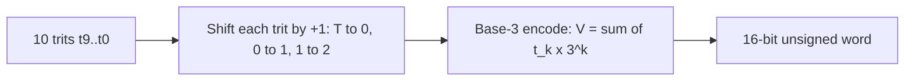
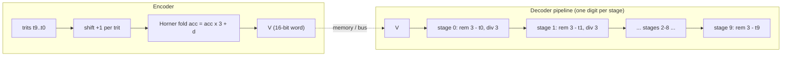
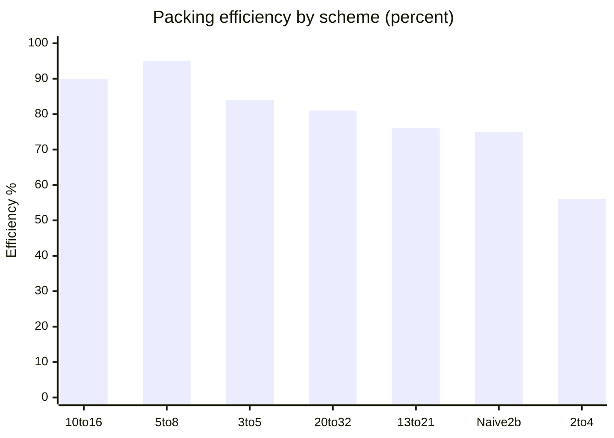
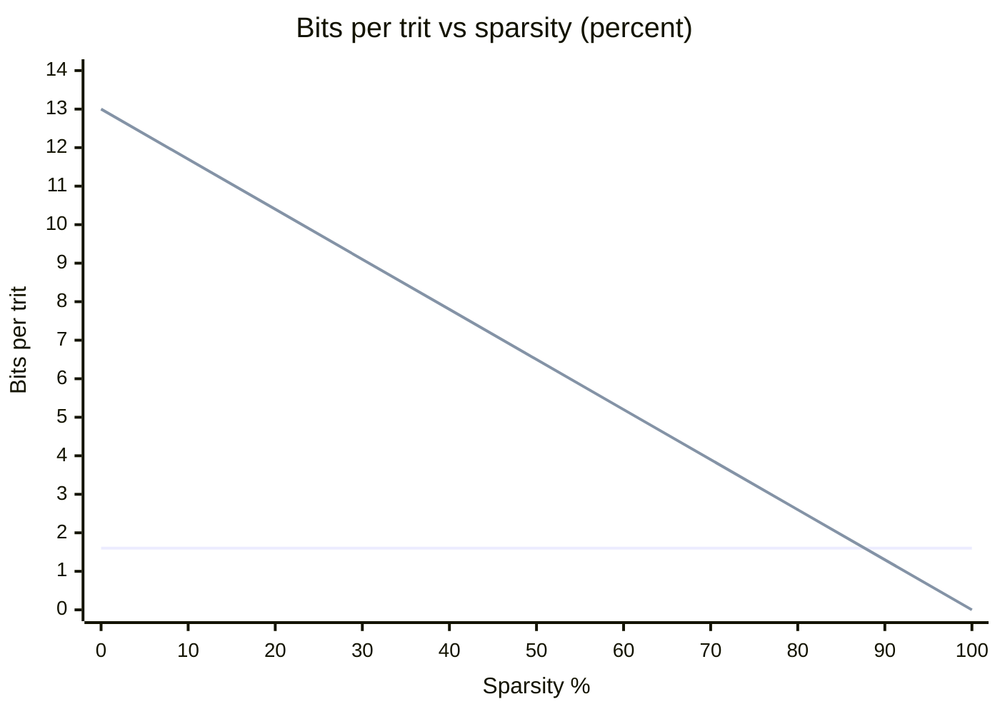
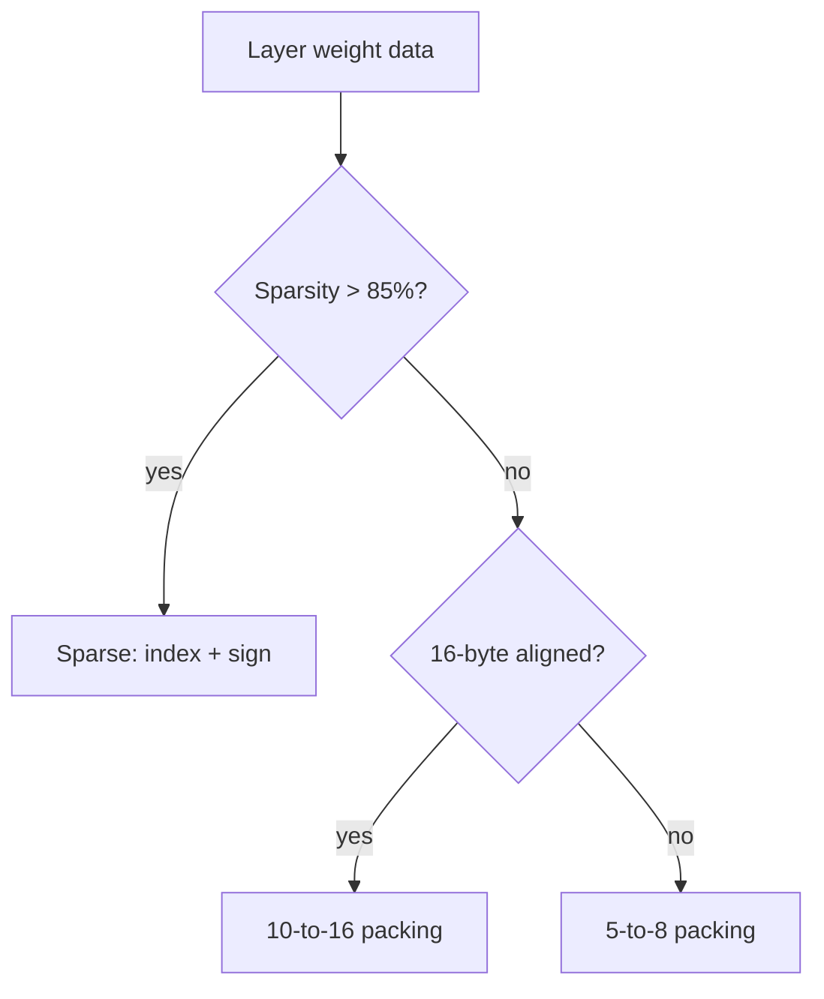
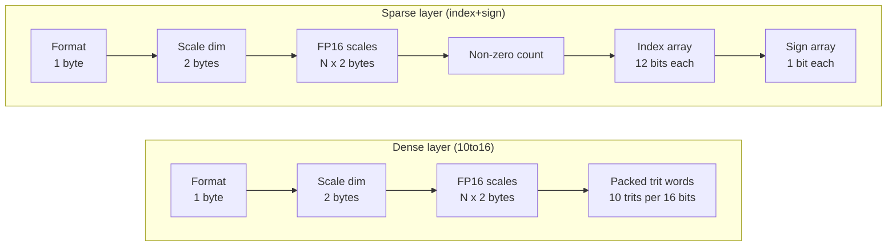

# 4. Binary Storage Format for Ternary Weights

## 4.1 Why Packing Matters

A single ternary value carries `log₂(3) ≈ 1.585` bits of information. Naively storing each trit in 2 bits wastes ~21% of storage. Efficient packing reduces memory traffic, which is the primary LLM bottleneck.

---

## 4.2 Packing Scheme: 10 Trits in 16 Bits

The fundamental observation:

```
3¹⁰ = 59,049
2¹⁶ = 65,536
```

So 10 trits can fit into 16 bits with only ~10% waste.

### Encoding

```
Given 10 trits: t₉, t₈, ..., t₀
Each trit maps: T→0, 0→1, 1→2
(shift by +1 to make non-negative)

Encoded value:
V = Σₖ₌₀⁹ tₖ × 3ᵏ

V ∈ [0, 3¹⁰ − 1] = [0, 59048]
Stored in a 16-bit unsigned integer.
```



### Elixir: 10-to-16 Packing and Unpacking

```elixir
defmodule TritPacking do
  @type trit :: -1 | 0 | 1

  @doc """
  Pack 10 trits into a 16-bit unsigned integer.
  Each trit is shifted by +1 to make it non-negative:
    T → 0, 0 → 1, 1 → 2
  """
  @spec pack([trit()]) :: non_neg_integer()
  def pack(trits) when length(trits) == 10 do
    trits
    |> Enum.map(&(&1 + 1))          # shift: -1→0, 0→1, +1→2
    |> Enum.reduce(0, fn digit, acc ->
       acc * 3 + digit
     end)
  end

  @doc """
  Unpack a 16-bit value into 10 trits.
  Uses repeated division by 3 to extract base-3 digits.
  """
  @spec unpack(non_neg_integer()) :: [trit()]
  def unpack(packed) when packed <= 59_049 do
    do_unpack(packed, [])
    |> Enum.reverse()
  end

  defp do_unpack(0, acc), do: acc
  defp do_unpack(v, acc) do
    digit = rem(v, 3)
    trit = case digit do
             0 -> -1   # mapping: 0→T
             1 ->  0   # 1→0
             2 ->  1   # 2→+1
           end
    do_unpack(div(v, 3), [trit | acc])
  end

  @doc """
  Pack a binary weight matrix into a flat list of 16-bit words.
  Each row is padded to a multiple of 10 trits.
  """
  @spec pack_matrix([[trit()]]) :: [non_neg_integer()]
  def pack_matrix(rows) do
    Enum.flat_map(rows, fn row ->
      row
      |> Enum.chunk_every(10)
      |> Enum.map(&pad_and_pack/1)
    end)
  end

  defp pad_and_pack(chunk) do
    padded = chunk ++
             List.duplicate(0, 10 - length(chunk))
    pack(padded)
  end
end
```

### Hardware Decoder

A 16-bit to 10-trit decoder can be built with:

- Comparison logic (V against precomputed thresholds)
- Small lookup table (base-3 digit extraction)
- Combinational logic, ~50-100 gates per output

### 4.2.1 Endianness and Bit Ordering

Trits should be packed in **little-endian order** (least significant trit first). The encoding formula places `t₀` in the least-significant position:

```
V = t₀ × 3⁰ + t₁ × 3¹ + … + t₉ × 3⁹
```

This ordering simplifies the hardware decoder because repeated division by 3 extracts digits starting from the least-significant trit. The first trit extracted (`t₀`) maps directly to the first processing element (PE) in the systolic array, eliminating a reversal step.

### 4.2.2 Worked Example: Pack and Unpack

Encoding is easiest to verify on a concrete word. Take the trit list in transmission order `t₉ … t₀`:

```
Input trits (t9..t0):  [1, T, 0, 1, 0, 0, T, 1, 0, 1]

Step 1 — shift each trit by +1 (T→0, 0→1, 1→2):
    [2, 1, 0, 2, 1, 1, 0, 2, 1, 2]

Step 2 — Horner base-3 fold (acc = acc × 3 + digit), first element is most significant:
    2                    = 2
    2×3 + 1              = 7
    7×3 + 0              = 21
    21×3 + 2             = 65
    65×3 + 1             = 196
    196×3 + 1            = 589
    589×3 + 0            = 1767
    1767×3 + 2           = 5303
    5303×3 + 1           = 15910
    15910×3 + 2          = 47732

Encoded word: V = 47732  (fits: 47732 ≤ 59048 = 3¹⁰ − 1)
```

Decoding runs the inverse — repeated `div 3` / `rem 3` emits digits least-significant first:

```
Unpack V = 47732:

  rem(47732, 3) = 2 → trit +1   div → 15910
  rem(15910, 3) = 1 → trit  0   div → 5303
  rem(5303, 3)  = 2 → trit +1   div → 1767
  rem(1767, 3)  = 0 → trit  T   div → 589
  rem(589, 3)   = 1 → trit  0   div → 196
  rem(196, 3)   = 1 → trit  0   div → 65
  rem(65, 3)    = 2 → trit +1   div → 21
  rem(21, 3)    = 0 → trit  T   div → 7
  rem(7, 3)     = 1 → trit  0   div → 2
  rem(2, 3)     = 2 → trit +1   div → 0    (stop)

Digits emitted LSB-first: t0..t9 = [1, 0, 1, T, 0, 0, 1, 0, T, 1]
Reversed → transmission order t9..t0 = [1, T, 0, 1, 0, 0, T, 1, 0, 1]  ✓ round-trip
```

The little-endian ordering of §4.2.1 is visible here: the first `rem` recovers `t₀ = +1`, which is exactly the trit the first PE consumes.

### 4.2.3 Validity, Padding, and Error Detection

Three properties of the base-3 encoding matter for robust storage:

1. **Range check = corruption check.** A valid encoded word satisfies `V ≤ 3¹⁰ − 1 = 59048`, so the top bits of the 16-bit word are constrained (V < 2¹⁶ means any `V ≥ 59049` is impossible from valid packing). A decoder (or the `validate` command in the converter) can detect bit flips in the upper bits with a single comparison — no checksum required for coarse corruption detection. For stronger guarantees, add an explicit CRC over the packed section (the `.tbin` container handles this at file level).

2. **Padding trits are zeros, not garbage.** Rows are padded to a multiple of 10 with trit `0` (§4.2 Elixir `pad_and_pack`), so padded digit positions hold the value `1` in base-3. The decoder must trim `layer_width mod 10` trits from the final word of each row using the layer metadata — it should never treat padding as weights.

3. **All-0-weights layers are still valid.** A word of ten zero-trits encodes to `V = 3¹⁰ − 1` pattern digits `1` → `V = (1111111111)₃ = 29524`. Note this is *not* `V = 0`: a zero word `V = 0` decodes to ten `T` (−1) trits. Sparse format detection (§4.8) must therefore key off the layer format byte, not off packed-word values.



Each `rem 3` / `div 3` stage is the same combinational block (~50–100 gates), so a pipelined decoder costs 10 identical stages and produces one trit per cycle per pipeline lane after fill — matching the decode-throughput needs of the systolic array in [05-hardware-architecture.md](05-hardware-architecture.md).

---

## 4.3 Packing Scheme: 5 Trits in 8 Bits

Smaller decode granularity:

```
3⁵ = 243
2⁸ = 256
```

5 trits fit in 8 bits with ~5% waste.

Advantages:

- Byte-aligned
- Easier to decode
- Better for sparse access patterns

Tradeoff: 11% more storage than 10-trit packing.

---

## 4.4 Packing Scheme: 20 Trits in 32 Bits

```
3²⁰ = 3,486,784,401
2³² = 4,294,967,296
```

20 trits fit in 32 bits with ~19% waste.

Advantages:

- Word-aligned
- Efficient for SIMD decode
- Good for dense GEMM

---

## 4.5 Comparison of Packing Schemes

| Scheme | Trits | Bits | Efficiency | Alignment | Decode Cost |
|--------|-------|------|------------|-----------|-------------|
| 10→16  | 10    | 16   | 90%        | Half-word | Medium      |
| 5→8    | 5     | 8    | 95%        | Byte      | Low         |
| 3→5    | 3     | 5    | 84%        | Nibble+   | Low         |
| 20→32  | 20    | 32   | 81%        | Word      | Higher      |
| 13→21  | 13    | 21   | 76%        | N/A       | Medium      |
| 2→4    | 2     | 4    | 56%        | Nibble    | Trivial     |
| Naive 2b| 1    | 2    | 75%        | Any       | None        |

**Recommended for hardware**: 5→8 (simple decoder, byte-aligned)
**Recommended for storage**: 10→16 (high density, moderate decoder)



---

## 4.6 Decoder Implementation (5→8)

```
Input:  8-bit value V
Output: 5 trits t₀..t₄ (each 2-bit encoded: 00=T, 01=0, 10=1)

Precomputed base-3 digit extraction:

d₀ = V % 3
d₁ = (V / 3) % 3
d₂ = (V / 9) % 3
d₃ = (V / 27) % 3
d₄ = (V / 81) % 3

tₖ = digit_to_trit(dₖ)
```

In hardware, division by 3 can be approximated with multiplication by the reciprocal of 3:

```
V / 3 ≈ V × 21845 >> 16  (for 16-bit arithmetic)
```

---

## 4.7 Sparse Ternary Format

When many weights are 0, a sparse format saves more than dense packing.

### Sparse Storage: Index + Sign

```
For each non-zero weight:
    Index: 12 bits  (position in flattened layer)
    Sign:   1 bit   (0 for +1, 1 for -1)
    Total:  13 bits per non-zero weight
```

### Storage Comparison

| Sparsity | Dense (10-to-16) | Sparse (index+sign) |
|----------|-------------------|---------------------|
| 0%       | 1.6 b/trit        | 13 b/trit           |
| 50%      | 1.6 b/trit        | 6.5 b/trit          |
| 75%      | 1.6 b/trit        | 3.25 b/trit         |
| 90%      | 1.6 b/trit        | 1.3 b/trit          |

Break-even point: ~88% sparsity.

Sparse cost scales linearly as 13 bits per non-zero trit, so index+sign wins once `13 × (1 − sparsity) < 1.6`, i.e. beyond ~88% sparsity:



### Block Sparse Format

Divide matrix into blocks (e.g., 32×32). Store each block as:

```
Block metadata:
    Bitmask: 1024 bits (which entries are non-zero)
    Values:  variable length (sign bits for each non-zero entry)
```

This gives better hardware efficiency than fully unstructured sparsity.

### 4.7.1 Run-Length Encoding for Ternary

For very sparse layers (>90% zeros), **run-length encoding (RLE)** can be more compact than index+sign. Instead of storing individual positions, encode runs of consecutive zeros as a single count value:

```
Encoding scheme:
  Zero run:  <0><count-1>     — count stored in unary or gamma coding
  Non-zero:  <1><sign><index>  — sign bit + position of next non-zero
```

**Comparison of sparse formats at 95% sparsity:**

| Format | Bits per trit | Decode complexity | Best for |
|--------|--------------|-------------------|----------|
| Dense (10→16) | 1.60 | Trivial | < 80% sparse |
| Index+sign | 0.65 | Low (sequential scan) | 80–95% sparse |
| RLE | ~0.40 | Medium (counter-based) | > 90% sparse |
| Block sparse | 0.80 | Low (bitmask lookup) | Structured sparsity |

RLE excels when zeros cluster in long runs (common in pruned attention layers). The decoder maintains a counter: on each cycle, if the counter is non-zero it emits a trit `0` and decrements; otherwise it reads the next encoded token. Hardware cost is a small counter + a state machine (~200 gates).

---

## 4.8 Hybrid Storage Design

Best design: support multiple formats and select per-layer.



### Layout in Memory

```
Layer metadata:
    Format:          1 byte
    Scale dimension: 2 bytes (per-channel or per-tensor)
    Scale data:      N × FP16 bytes
    Sparsity mask:   optional (for sparse format)
    Weight data:     packed trits

Example dense layer (10→16 packing):
    [Format byte][Scale dim][FP16 scales...
     packed trit words...]

Example sparse layer:
    [Format byte][Scale dim][FP16 scales...
     non-zero count][index array...][sign array...]
```



**Format metadata overhead:** Each layer requires 1 byte for the format identifier + 2 bytes for the scale dimension + the scale data itself (N × 2 bytes for FP16). For a 32-layer model with per-channel scaling on typical dimensions, total metadata is approximately **130 KB** — negligible compared to the weight storage.

---

## 4.9 Lookup Table (LUT) Decode

For very small weight matrices (e.g., 4×4 convolution kernels), a full decoder is unnecessary. Use a LUT:

```
16-bit word → 10 trits

LUT size: 2¹⁶ × 10 × 2 bits = 160 KB

Alternative: Two-level LUT
    Upper byte → first 5 trits (256 entries × 10 bits = 320 bytes)
    Lower byte → last 5 trits (256 entries × 10 bits = 320 bytes)
    Total: 640 bytes + OR gate
```

---

## 4.10 Matrix Transpose for Ternary Data

Ternary matrix multiplication requires both row and column access.

If weights are stored row-major in packed format, accessing a column requires extracting one trit from many different words.

### Transpose Buffer

```
On load, optionally transpose:

Row-major storage → Transpose buffer → Column-major output

Transpose buffer: shift-register array, pipelined
```

### Alternative: Store Twice

```
W_original:  row-major packed
W_transposed: column-major packed

Storage cost: 2×
Decode benefit: efficient column access
```

### Better Alternative: Decode-On-The-Fly

During a GEMM, stream packed data through a decoder that emits one row at a time. Column access is handled by the systolic array's natural dataflow.

---

## 4.11 Summary of Storage Advice

| Use Case | Format | Reason |
|----------|--------|--------|
| Dense weights, hardware decode | 5→8 packing | Byte-aligned, simple decoder |
| Dense weights, storage only | 10→16 packing | Best density |
| Sparse model (>85% zeros) | Index+sign sparse | Lower total bits |
| Software inference | 5→8 packing | Easy SIMD decode |
| Small kernels (<64 weights) | 2-bit naive | No decode overhead |
| SRAM buffer | 10→16 packing | Density, moderate decode |

---

### 4.12 Memory Bandwidth Calculation

### Worked Example: 1B Parameter Model with 10→16 Packing

**Storage required:**

```
1B parameters × 1.6 bits/trit (10→16 packing) = 1.6 Gb = 200 MB
```

**Transfer time at 1 GHz with a 256-bit bus:**

```
Bus bandwidth = 256 bits × 1 GHz = 32 GB/s
Transfer time  = 200 MB / 32 GB/s
              = 200M bytes / 32B per cycle
              = 6.25M cycles
              = 6.25 ms
```

**Comparison with FP16/BF16:**

```
1B parameters × 16 bits = 2 GB
Transfer time = 2 GB / 32 GB/s = 62.5 ms
```

**Comparison with FP32:**

```
1B parameters × 32 bits = 4 GB
Transfer time = 4 GB / 32 GB/s = 125 ms
```

| Metric | Ternary (10→16) | FP16/BF16 | FP32 | Ratio vs FP16 |
|--------|-----------------|-----------|------|---------------|
| Storage | 200 MB | 2 GB | 4 GB | 10× |
| Transfer time | 6.25 ms | 62.5 ms | 125 ms | 10× |

The 10× reduction in memory bandwidth vs FP16 directly translates to faster weight loading and lower energy per inference, since DRAM access dominates energy consumption in LLM serving.