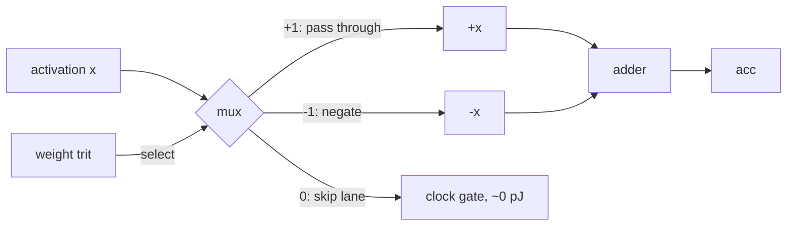
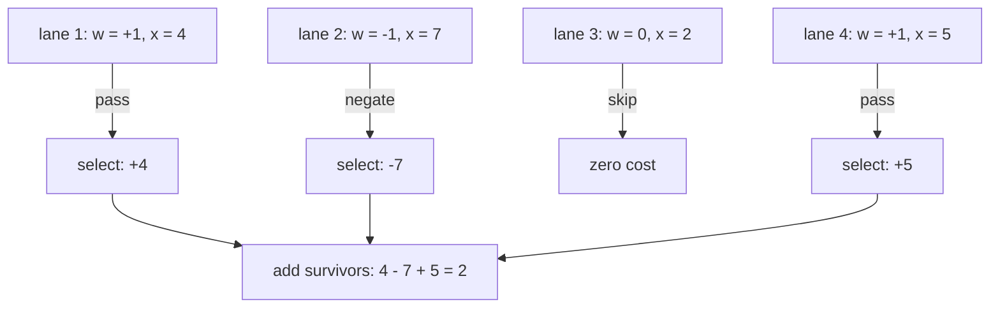
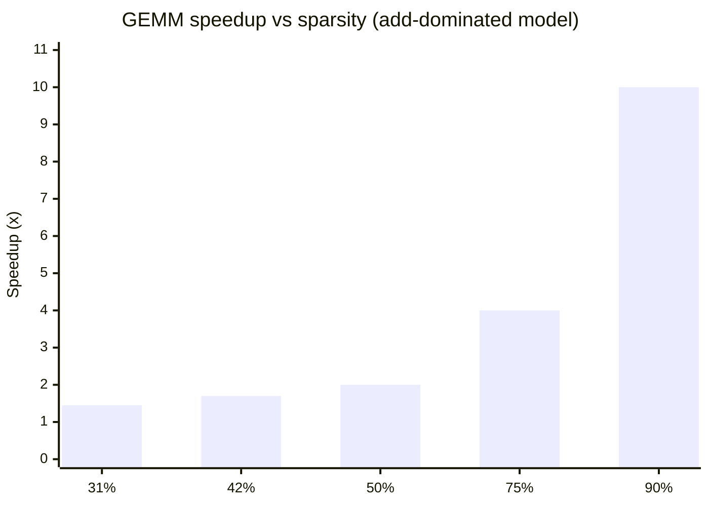
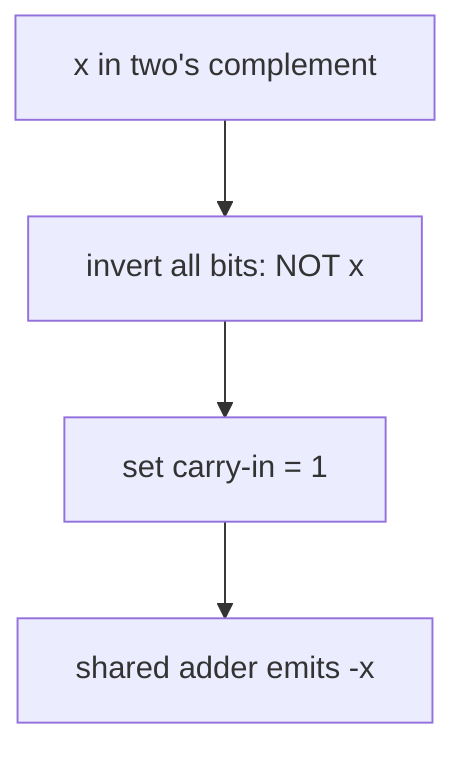

# 18. Multiplication Becomes Selection

## 18.1 Where the Energy Goes

A neural network is overwhelmingly one operation — the multiply-accumulate:

```
output = Σ wᵢ × xᵢ
```

In conventional silicon, the multiplier is the most expensive part of that
expression by a wide margin. Approximate costs per MAC unit (same order of
magnitude across process nodes; ratios are what matter):

| Precision | Multiplier Area (rel.) | Energy per MAC (rel.) | Why |
|-----------|------------------------|------------------------|-----|
| FP32      | 100%                   | ~1.0                   | mantissa alignment, normalization, rounding |
| FP16      | ~25%                   | ~0.3                   | narrower datapath, same control complexity |
| INT8      | ~6%                    | ~0.2                   | simple array multiplier, no exponent logic |
| Ternary   | **~0%**                | **~0.05**              | **no multiplier at all** |

Two observations drive the ternary design space:

1. **The multiply is redundant.** When `w ∈ {-1, 0, +1}`, the product
   `w × x` is always one of `{−x, 0, +x}` — a value that already exists on
   a wire. No computation is required to produce it.
2. **The add remains.** Accumulation cannot be removed, so the floor for a
   ternary MAC is one addition — roughly the energy of an INT8 adder.

## 18.2 The Selection Principle

With ternary weights, multiplication degenerates into **selection**:

| Weight trit | Product | Hardware action | Cost |
|-------------|---------|-----------------|------|
| +1          | +x      | pass activation through | wire |
| 0           | 0       | skip lane entirely      | clock gate (≈0 pJ) |
| −1          | −x      | negate                  | ~4 transistors |

The entire MAC shrinks to:



The trit is the select signal: `+1` closes the pass path, `−1` closes the
negation path, and `0` gates the lane before the adder ever toggles.

Compare with an INT8 multiplier: partial-product generation, Wallace tree,
carry-propagate adder, pipeline registers. The ternary PE replaces all of it
with a mux and reuses one adder per column of the array.

## 18.3 Worked Example

Inputs and weights for one output neuron (T means −1):

```
Inputs:   [4, 7, 2, 5]
Weights:  [1, T, 0, 1]
```

**Conventional** — 4 multiplications + 3 additions:

```
4×1 + 7×(−1) + 2×0 + 5×1 = 4 − 7 + 0 + 5 = 2
```

**Ternary** — select first, then only add survivors:

```
select:   [ +4 | −7 | skip | +5 ]
add:      4 − 7 + 5 = 2
```



3 effective operations instead of 7, and the skipped lane costs nothing.
At 75% sparsity the pattern generalizes: only 1 in 4 lanes drives its adder.

### A Two-Layer Chain

Layer 1 (`{64→32}`) followed by layer 2 (`{32→16}`), both 75% sparse:

| Stage | Dense ops | Ternary ops (75% sparse) |
|-------|-----------|--------------------------|
| Layer 1 MACs | 2048 | 512 adds |
| Layer 2 MACs | 1024 | 256 adds |
| Total | 3072 | 768 adds (**4× fewer**) |

## 18.4 Operation-Count Model

For a layer with `N` weights at sparsity `s` (fraction of exact zeros):

```
dense_ops   = N multiplications + (N−1) additions
ternary_ops = (1 − s)·N selections + ((1 − s)·N − 1) additions
speedup     ≈ 1 / (1 − s)        (add-dominated model)
```

| Sparsity s | Effective speedup | Notes |
|------------|-------------------|-------|
| 31% (absmean PTQ) | ~1.45× | BitNet b1.58 rule on Gaussian weights |
| 42% (TWN rule)    | ~1.7×  | TWN threshold |
| 50%               | 2×     | interquartile optimum |
| 75%               | 4×     | aggressive training target |
| 90%               | 10×    | requires accuracy recovery techniques |



Caveats (see also [Sparsity Economics](19-sparsity-economics.md)):

- Speedup applies to GEMM only; attention softmax/LayerNorm overhead bounds
  end-to-end gains (Amdahl's law).
- Skipping must actually save energy — which requires hardware support:
  clock gating per lane, not just branching around zeros in software.
- Memory-bound regimes gain from sparsity only if the storage format omits
  zeros ([Storage Format](04-storage-format.md)).

## 18.5 Datapath Details

### Negation

Activations arrive in two's complement. Negation is invert-plus-one:

```
−x = ~x + 1
```

The `+1` folds into the adder's carry-in — negation costs the inverter only,
which is why the "4 transistors" figure holds per bit-slice.



### Accumulator Width

Summing `K` terms of width `B` bits needs:

```
acc_width ≥ B + ⌈log₂(K)⌉ + 1     (+1 for sign)
```

Example: INT8 activations, K = 4096 → 8 + 12 + 1 = 21 bits. Standard
practice; identical to INT8 accelerators. Saturation can cap this at 16 bits
with negligible error when scales absorb the range afterwards.

### Adder Tree vs Sequential Accumulate

A `{out × in}` weight matrix produces `in` products per output channel.
Hardware options:

| Style | Latency | Area | Used in |
|-------|---------|------|---------|
| Adder tree (log₂ depth) | O(log K) cycles-equivalent | high | high-throughput arrays |
| Sequential accumulate | K cycles | minimal (one adder/PE) | systolic designs ([ASIC spec](12-custom-ternary-accelerator-design.md)) |

## 18.6 Comparison with Other Multiplier-Free Approaches

| Approach | How it avoids multipliers | Precision | Catch |
|----------|---------------------------|-----------|-------|
| Binary {−1,+1} | selection like ternary | 1 bit/weight | no pruning state; accuracy drops 5–10% |
| Shift-add networks | powers-of-two weights | ~2–3 bits | constrained values; training harder |
| LUT-based mult | precomputed tables | any | LUT area grows quadratically with bit width |
| **Ternary {−1,0,+1}** | **selection + gating** | **1.585 bits/weight** | custom datapath preferred |

Ternary is the only scheme that removes the multiplier *and* encodes
sparsity *and* keeps near-bit-level simplicity.

## 18.7 Simulating the Datapath in Elixir

The shipped tool implements exactly this arithmetic in
[`Layer.forward/2`](../tools/ternary_converter/lib/ternary_converter/layer.ex):

```elixir
dot =
  Enum.zip(w_row, activations)
  |> Enum.reduce(0.0, fn
    {1, x}, acc -> acc + x      # pass through
    {-1, x}, acc -> acc - x     # negate
    {0, _x}, acc -> acc         # skip — zero work
  end)

dot * scale + bias
```

No multiplication appears between weights and activations anywhere in the
forward path. The GPU example in
[`examples/ternary_accel/`](../../examples/ternary_accel/) performs the same
decode step inside compiled Nx kernels (`decode_weights/2`) — the software
analogue of the mux-and-gate PE.

## 18.8 Summary

- Removing the multiplier removes the dominant term of MAC cost.
- Ternary turns `w × x` into select-add-skip; the adder is shared and the
  zero trit gates whole lanes for free.
- Operation savings scale as `1/(1 − s)` with sparsity `s`; realistic
  quantization rules deliver 1.4–2×, trained targets up to 4–10×.
- Everything above composes with the storage win — smaller weights *and*
  simpler math point at the same PE design specified in
  [Custom Accelerator Design](12-custom-ternary-accelerator-design.md).

---

## 18.9 Knowledge Check

### Concept Questions

**Q1.** Why does the ternary PE still need an adder if multiplication is
free? What sets its width?

**Q2.** A colleague claims ternary saves energy because "multiplying by ±1
and 0 is cheap even in FP16." Where is their mental model wrong?

**Q3.** Why is skipping zeros only free when hardware supports per-lane
clock gating? What happens on a GPU running dense matmul?

### Calculations

**Q4.** A layer has `K = 1024` inputs, INT8 activations. What accumulator
width guarantees no overflow?

**Q5.** At 60% sparsity, what GEMM speedup does the add-dominated model
predict? What density assumption breaks at very high sparsity?

**Q6.** Two-layer chain: `{512→256}` then `{256→128}`, both 75% sparse.
Compute dense vs ternary operation counts.

### Hands-On Lab

Run the datapath simulation and verify the op-count model yourself:

```bash
cd tools/ternary_converter && mix deps.get

# Observe effective MACs and SQNR at several thresholds
mix run -e 'TernaryConverter.CLI.main(["demo", "--rows", "128", "--cols", "256", "--delta", "0.3"])'
mix run -e 'TernaryConverter.CLI.main(["demo", "--rows", "128", "--cols", "256", "--delta", "0.6"])'
```

Exercises:
1. Record effective-MAC percentage for each delta; relate it to the
   threshold's zero fraction.
2. Read `Layer.forward/2` in the tool source; identify where pass /
   negate / skip happen. Modify it to count additions executed and check
   the count equals `(1 − s) · K`.

### Answer Key

<details>
<summary>Click to reveal</summary>

**A1.** Products `{−x, 0, +x}` must still be **summed** into one output;
selection removes the multiply, not the accumulation. Width follows
§18.5: `B + ⌈log₂K⌉ + 1` bits (INT8, K=1024 → 19 bits).

**A2.** In FP16, computing `w × x` costs a full FP16 multiplier regardless
of the operand's value — the hardware doesn't know w ∈ {−1,0,+1} unless
the *format* encodes it. Savings come from removing the multiplier from
the datapath, not from lucky operand values.

**A3.** Without gating, every lane computes `w_decode · x` including zeros;
the work is done anyway. On GPUs, zeros also occupy tensor-core slots and
dense weight traffic still streams from HBM — software branches around
zeros often cost more than they save ([19](19-sparsity-economics.md)).

**A4.** `8 + ⌈log₂ 1024⌉ + 1 = 8 + 10 + 1 = 19 bits`.

**A5.** `1/(1 − 0.6) = 2.5×`. The model assumes cost is purely additive
over surviving weights; near 90%+ sparsity, address/index overhead and
irregular memory access add terms that the linear model ignores.

**A6.** Dense: `512·256 + 256·128 = 131072 + 32768 = 163840` MACs.
Ternary: `(1 − 0.75) × 163840 = 40960` effective adds → 4× fewer.

</details>
