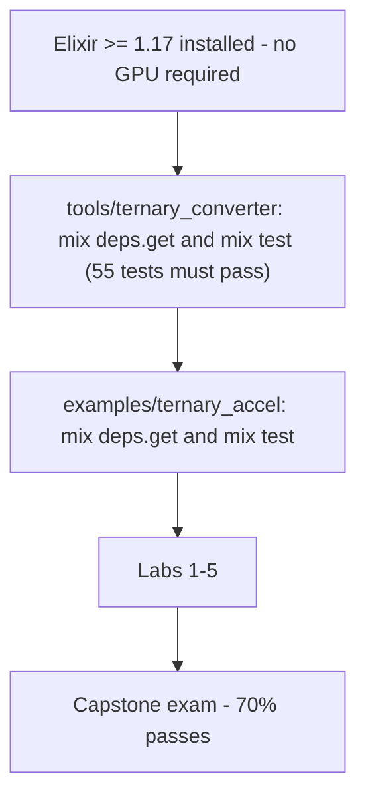
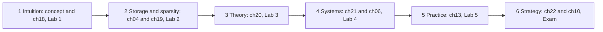
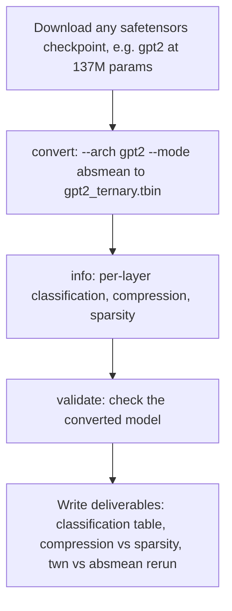

# 23. Practical Labs and Certification Exam

A self-contained study path through this repository: reading order, five
hands-on labs using the real toolchain, and a capstone exam with answer key
and grading rubric.

**Prerequisites**: Elixir ≥ 1.17; no GPU required (labs fall back to CPU).

```bash
# One-time setup for everything below
cd tools/ternary_converter && mix deps.get && mix test   # 55 tests must pass
cd ../../examples/ternary_accel && mix deps.get && mix test
```



## 23.1 Curriculum Map

| Stage | Read | Do | Mastery signal |
|-------|------|----|----------------|
| 1. Intuition | [concept](../concept.md), [18](18-multiplication-as-selection.md) | Lab 1 | can explain why multipliers vanish |
| 2. Storage & sparsity | [04](04-storage-format.md), [19](19-sparsity-economics.md) | Lab 2 | can compute breakeven sparsity |
| 3. Theory | [20](20-quantization-theory.md) | Lab 3 | can predict zero fractions before measuring |
| 4. Systems | [21](21-memory-bandwidth-analysis.md), [06](06-llm-inference-engine.md) | Lab 4 | can size bandwidth for a model+target |
| 5. Practice | [13](13-model-conversion-guide.md) | Lab 5 | converts real checkpoints end-to-end |
| 6. Strategy | [22](22-history-and-vision.md), [10](10-comparison.md) | Exam | passes rubric below |



---

## 23.2 Labs

### Lab 1 — Feel the Datapath (30 min)

**Goal**: internalize pass/negate/skip.

```bash
cd tools/ternary_converter
mix run -e 'TernaryConverter.CLI.main(["demo", "--rows", "64", "--cols", "128", "--delta", "0.4"])'
```

Tasks:
1. From the printed effective-MAC percentage, predict the GEMM speedup;
   then verify against `1/(1 − s)` from [18](18-multiplication-as-selection.md).
2. Open `lib/ternary_converter/layer.ex` → `forward/2`; annotate each
   branch with its hardware analogue (wire / inverter / clock gate).
3. Re-run with `--delta 0.7` and `--delta 0.1`. Record SQNR at each.
   Which direction does SQNR move, and why?

### Lab 2 — Packing Economics (45 min)

**Goal**: verify storage claims numerically.

```elixir
t = Nx.Random.normal(Nx.Random.key(1), 0.0, 0.05, shape: {512, 512}) |> elem(0)
trits = TernaryConverter.Quantizer.ternarize(t, 0.05)

packed = TernaryConverter.Packer.pack(trits)
sparse = TernaryConverter.Packer.pack_sparse(trits)

dense_bits  = byte_size(packed) * 8 / (512 * 512)
sparse_bits = byte_size(sparse) * 8 / (512 * 512)

IO.puts("dense #{dense_bits} bits/wt, sparse #{sparse_bits} bits/nonzero-weight-space")
```

Tasks:
1. Confirm dense ≈ 1.6 bits/weight (10→16 packing).
2. Compute the layer's sparsity; show why index+sign loses here
   (breakeven is ~90%, see [19](19-sparsity-economics.md)).
3. Verify round-trip: `Packer.unpack(packed, 512*512)` equals the trit list.

### Lab 3 — Rule Verification (45 min)

**Goal**: reproduce §20.6's table from scratch.

```elixir
w = Nx.Random.normal(Nx.Random.key(42), 0.0, 0.05, shape: {256, 256}) |> elem(0)

zeros = fn t -> Nx.sum(Nx.equal(t, 0)) |> Nx.divide(Nx.size(t)) |> Nx.to_number() end

for mode <- [:delta, :twn, :absmean] do
  {trits, _scales, delta} = TernaryConverter.Quantizer.quantize(w, mode: mode)
  IO.puts("#{mode}: Δ=#{Float.round(delta, 4)} zeros=#{Float.round(zeros.(trits) * 100, 1)}%")
end

{d, actual} = TernaryConverter.Quantizer.auto_threshold(w, 0.5)
IO.puts("bisect: Δ=#{Float.round(d, 4)} zeros=#{Float.round(actual * 100, 1)}%")
```

Pass criteria: absmean ∈ [29%, 33%], twn ∈ [40%, 44%], bisect within ±1%
of target. Explain any deviation from theory using σ vs mean|W| ratios.

### Lab 4 — Bandwidth Sizing (30 min, pen and paper)

Using [21](21-memory-bandwidth-analysis.md):

1. Size the decode-phase bandwidth for a **7B** ternary model at
   **12 tokens/s**, batch 1, ignoring KV.
2. Add KV: 32 layers, 8 KV heads, 128 head_dim, f16 cache, seq_len 2048.
   What fraction of traffic is now KV?
3. At what batch size does this workload hit a 400 TFLOP/s / 2 TB/s GPU's
   compute roofline?
4. Check your answers against the demo:

```bash
cd examples/ternary_accel
mix run -e 'TernaryAccel.run()'
```

### Lab 5 — Real Model Conversion (60 min)

**Goal**: full production path on any HuggingFace checkpoint.



```bash
# Any safetensors model, e.g. gpt2 (137M):
# huggingface-cli download gpt2  # then locate model.safetensors

cd tools/ternary_converter
mix run -e 'TernaryConverter.CLI.main(["convert",
  "--input", "/path/to/model.safetensors",
  "--arch", "gpt2", "--mode", "absmean",
  "--output", "gpt2_ternary.tbin"])'

mix run -e 'TernaryConverter.CLI.main(["info", "--model", "gpt2_ternary.tbin"])'
mix run -e 'TernaryConverter.CLI.main(["validate", "--model", "gpt2_ternary.tbin"])'
```

Deliverables to write down:
1. Per-layer classification table (how many ternary / fp16 / skipped, and
   which names landed where — compare against §13.4 recipes).
2. Compression ratio and overall sparsity; do conv1d weights appear as
   `(out, in)`? (GPT-2 transposition — check `c_attn` shape.)
3. Re-run with `--mode twn`: which mode yields more zeros on *this*
   checkpoint? Does it match the Gaussian prediction or deviate? Why?

---

## 23.3 Capstone Exam

Closed-book for sections A–B; calculator allowed for C; toolchain allowed
for section D. Time budget: 90 minutes. **70% passes.**

### Section A — Concepts (20 points, 2 each)

A1. State the single most important advantage of balanced ternary for
    neural networks in one sentence.

A2. Give the three hardware actions that replace multiplication, and
    their relative costs.

A3. Why does the zero trit fuse quantization and pruning?

A4. Name the two-wire trit encoding and the two operations it makes
    trivially cheap.

A5. What precision handles activations, attention scores, softmax, and
    LayerNorm in the hybrid architecture, and why not ternarize them?

A6. Write the absmean rule. What is its implicit threshold in units of γ?

A7. What does TWN stand for, what is its Δ rule, and what assumption
    about weights underpins it?

A8. Define arithmetic intensity and give its value at batch 1 for a
    b-bit weight format.

A9. Give two reasons Setun-style ternary lost to binary despite radix
    economy.

A10. Order these by bits/weight ascending: INT4, FP8, binary, ternary,
     INT8, FP32.

### Section B — True/False, justify in ≤1 line (12 points, 2 each)

B1. Removing the multiplier removes all MAC cost.
B2. Sparse index+sign storage beats dense packing above ~88–90% zeros.
B3. Higher sparsity always improves end-to-end latency on GPUs.
B4. Absmean quantization changes if you scale all weights by 100×.
B5. Per-channel scales recover most PTQ accuracy loss at ~2% storage cost.
B6. At batch 256 prefill, ternary's advantage over FP32 comes mainly
    from memory bandwidth.

### Section C — Calculations (28 points)

C1. (6) Layer `{2048→512}`, INT8 activations, K=2048 terms. Minimum
    accumulator width without saturation?

C2. (6) A checkpoint ternarizes to 58% zeros. Predict GEMM speedup and
    dense-packed size of a 500M-parameter version (MB, 2 decimals).

C3. (8) For Gaussian W, σ = 0.02:
    a) mean|W| = ?
    b) TWN Δ = ?
    c) interquartile Δ = ?
    d) absmean decision boundary = ?

C4. (8) A 1.5B-parameter ternary LLM decodes at batch 1 on a device with
    68 GB/s:
    a) bytes/token (weights only)?
    b) theoretical token ceiling/s?
    c) after moving weights to on-chip SRAM, what bounds tokens/s now?
    d) at what approximate batch does this GPU become compute-bound for
       ternary (AI ≈ 10·B)?

### Section D — Practical (40 points)

Using the toolchain, produce and defend results:

D1. (15) Create a synthetic `{128, 512}` Gaussian tensor. Convert it via
    all three modes; report zeros, Δ, and MSE from `quality_metrics/2`.
    Identify which mode minimizes MSE and relate it to §20.6.

D2. (15) Build a llama-shaped safetensors file (embed, q/k/v/o_proj,
    gate/up/down, norms, lm_head). Convert with `--arch llama`. Verify:
    exactly the projections went ternary; embeddings/norms/lm_head are
    fp16; buffers skipped. Print your `info` output as evidence.

D3. (10) Your PM demands "exactly 65% zeros" on one layer regardless of
    distribution shape. Which API call implements this, and why is it
    guaranteed to converge?

### Rubric

| Section | Points | Pass floor |
|---------|--------|------------|
| A Concepts | 20 | 14 |
| B True/False | 12 | 8 |
| C Calculations | 28 | 18 |
| D Practical | 40 | 26 |
| **Total** | **100** | **70** |

Scoring notes: Section D is verified by running your commands — wrong
numbers copied from theory when the tool disagrees score zero; explain
deviations instead ([20](20-quantization-theory.md) §20.6 gives tolerance
bands).

---

## 23.4 Answer Key

<details>
<summary>Section A</summary>

A1. The zero trit turns pruning into a free byproduct of quantization —
near-zero weights skip computation entirely.

A2. Pass-through (a wire), negate (~4 transistors/inverter), skip
(clock gate ≈ 0 pJ); accumulation still needs an adder.

A3. The trit value 0 is simultaneously the quantization level for
insignificant weights and the pruning decision — one format encodes both.

A4. Differential (two-wire) encoding; wire-swap negation and NOR-gate
zero detection.

A5. Activations INT8; attention scores, softmax, LayerNorm stay FP16 —
they need exponent range / numerical sensitivity, and they are <10% of
compute so ternarizing them buys little and risks much.

A6. `γ = mean(|W|); T = roundclip(W/γ, −1, +1)`; implicit Δ = 0.5γ.

A7. Ternary Weight Networks (Li & Liu, 2016); Δ ≈ 0.7 × mean|W|;
approximately Gaussian i.i.d. weights.

A8. AI = FLOPs/bytes moved; at batch 1 decode AI = 16/bits FLOP/B,
independent of model size.

A9. Binary gates need one threshold region (simpler switches) and give
maximal noise margins per level; plus ecosystem lock-in once tools/ISAs
standardized.

A10. binary (1) < ternary (1.585) < INT4 (4) < FP8 = INT8 (8) < FP32 (32).

</details>

<details>
<summary>Section B</summary>

B1. False — accumulation remains and sets the energy floor (§18.1).
B2. True — 16(1−s) = 1.6 ⟹ s = 90%; block-sparse variants lower it a bit.
B3. False — GPUs execute dense matmul; zeros occupy slots, and software
skips often cost more than they save without lane gating.
B4. False — W/γ is scale-invariant; T unchanged (only stored γ changes).
B5. True — the standard recipe in [13](13-model-conversion-guide.md)/[02](02-weight-quantization.md).
B6. False — large batch raises AI ∝ B into the compute-bound regime; the
win shifts to cheaper PEs (§21.5).

</details>

<details>
<summary>Section C</summary>

C1. 8 + ⌈log₂ 2048⌉ + 1 = 8 + 11 + 1 = **20 bits**.

C2. Speedup = 1/0.42 ≈ **2.38×**. Size = 5e8 × 1.585/8 bytes =
99.06 MB → **≈ 99 MB**.

C3. mean|W| ≈ 0.798σ = 0.0160. TWN Δ = 0.7 × 0.0160 = **0.0112**.
Interquartile Δ = 0.674 × 0.02 = **0.0135**. Absmean boundary =
0.5 × 0.0160 = **0.0080**.

C4. a) 1.5e9 × 1.585/8 ≈ 0.30 GB/token. b) 68/0.30 ≈ **228 tokens/s**.
c) On-chip-resident weights remove the DRAM bound → activation movement,
KV reads, and add-array throughput bound it (§21.4). d) AI ≈ 200 needed
⟹ B ≈ 200/10 = **~20**.

</details>

<details>
<summary>Section D — verification hints</summary>

D1. Expect zeros: delta-mode depends on chosen Δ (with default resolution
order an explicit delta implies fixed mode); twn ≈ 42%; absmean ≈ 31%.
The LS-scale MSE minimum across Δ typically lands near the TWN region —
consistent with the joint optimum derivation.

D2. Classification counts: 6 ternary (q/k/v/o, gate/up/down), fp16 for
embed_tokens/lm_head/norms (≥2), rotary buffers skipped. `c_attn`-style
transposition applies only to GPT-2 preset, not llama.

D3. `Quantizer.auto_threshold(w, 0.65)` — bisection converges because the
zero fraction z(Δ) is monotone non-decreasing in Δ on [0, 4σ], guaranteeing
a unique root reached by interval halving (§20.8).

</details>
