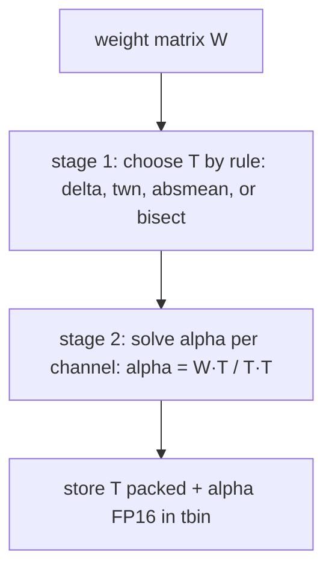
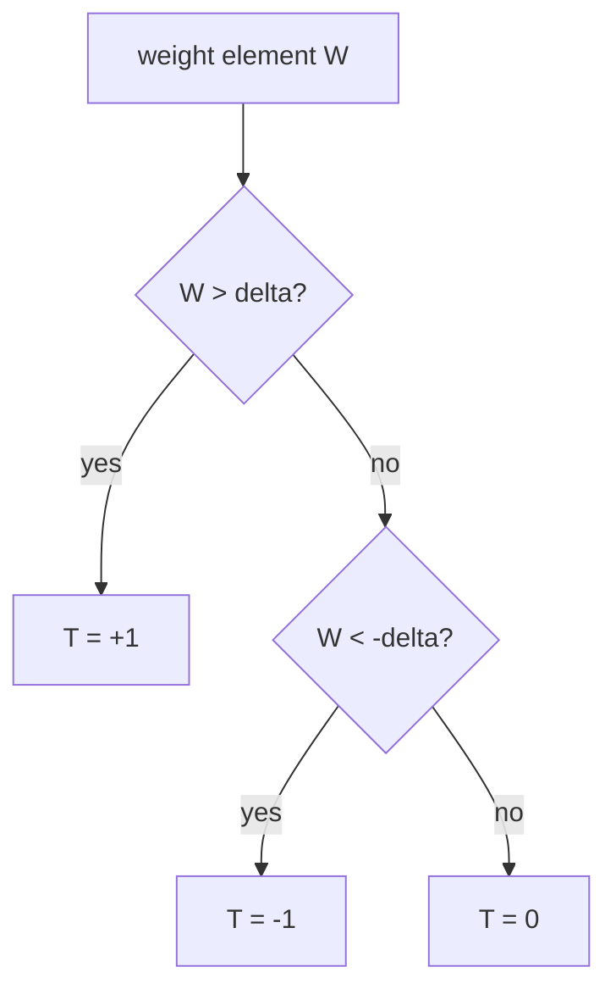
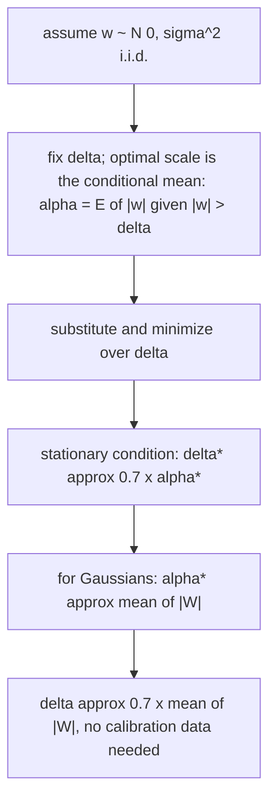
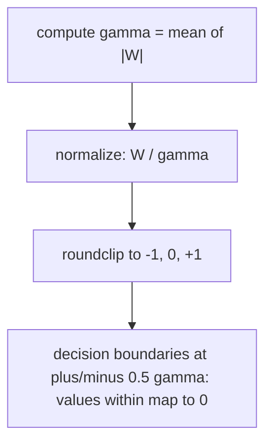
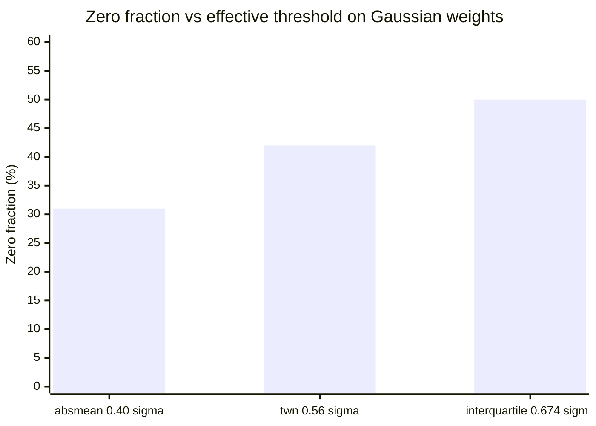
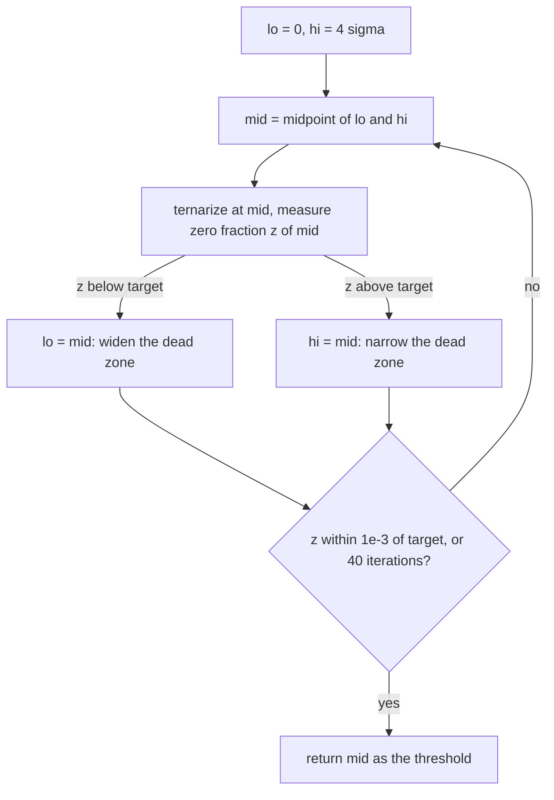

# 20. Quantization Theory: Thresholds and Scales

This chapter derives the ternarizer rules used throughout the project and
maps each to its implementation in
[`tools/balanced_ternary_engine`](../tools/balanced_ternary_engine/). For the practical
quantizer pipeline (clipping, per-layer sensitivity, QAT) see
[Weight Quantization Strategy](02-weight-quantization.md); this chapter is
the math underneath it.

## 20.1 The Approximation Problem

Given a weight matrix `W ∈ ℝ^{out×in}`, find trits and scales minimizing
reconstruction error:

```
minimize   ‖W − α ⊙ T‖²_F
subject to T[i,j] ∈ {−1, 0, +1}
           α ∈ ℝ^out   (per output channel)
```

Exact minimization is combinatorial over `T`, but the problem separates:

1. **Fix `T`** → optimal `α` is a closed-form least-squares solve.
2. **Fix the rule that produces `T`** → choose among three proven rules.

All shipped modes follow this two-stage structure; they differ only in how
`T` is chosen.



## 20.2 Stage One: Optimal Scale Given T

For row `j` (one output channel), minimize `‖W_j − α_j T_j‖²`:

```
d/dα_j ‖W_j − α_j T_j‖² = −2 T_j·(W_j − α_j T_j) = 0
⟹  α_j* = (W_j · T_j) / (T_j · T_j)
```

Implementation — `Quantizer.compute_scales/2`:

```elixir
dot  = Nx.sum(Nx.multiply(weights, ternary), axes: [1])
norm = Nx.sum(Nx.pow(ternary, 2), axes: [1])
safe_norm = Nx.select(Nx.greater(norm, 0.0), norm, Nx.tensor(1.0))
Nx.divide(dot, safe_norm)
```

Notes:

- Rows with no nonzero trits (`norm = 0`) get scale 0 — a dead output
  channel, which is valid but worth flagging during validation.
- Outlier channels distort `α_j`; the clipped variant
  (`compute_scales_clipped/3`) caps each channel at ±3σ before solving.
- Storing `α` in FP16 costs ~2% overhead for typical layer widths and is
  part of the `.tbin` format ([Storage](04-storage-format.md)).

## 20.3 Rule 1: Fixed Threshold

```
T[i,j] = +1  if W[i,j] > Δ
         −1  if W[i,j] < −Δ
          0  otherwise
```

Everything hinges on Δ. Three principled ways to pick it follow.



## 20.4 Rule 2: TWN Threshold — Joint Optimization

*Ternary Weight Networks* (Li & Liu, 2016) minimizes the reconstruction
error jointly over `α` and `T` under an approximately Gaussian assumption.

Sketch of the derivation:

1. Assume `w ~ N(0, σ²)` i.i.d.
2. With threshold Δ fixed, the optimal scale is the conditional mean:
   `α*(Δ) = E[|w| | |w| > Δ]`.
3. Substituting back and minimizing over Δ yields the stationary condition
   `Δ* ≈ 0.7·α*`. Numerically for Gaussians, `α* ≈ mean(|W|)` and hence:

```
Δ ≈ 0.7 × mean(|W|)        α ≈ mean(|W|)
```

Properties:

- **No calibration data required** — one pass over the weights.
- Robust to outliers because `mean|W|` averages rather than takes maxima.
- Implementation: `Quantizer.twn_delta/1`; default mode `twn`.

The refinement step (per-channel least-squares α from §20.2 on top of the
global Δ) typically improves on the single shared α from the original paper
— both are available in the tool.



## 20.5 Rule 3: Absmean Rounding (BitNet b1.58)

*BitNet b1.58* (Ma et al., 2024) removes the threshold search entirely:

```
γ = mean(|W|)
T = roundclip(W / γ, −1, +1)
```

Decision boundaries sit at ±0.5γ: normalized values within ±0.5 round to 0,
beyond that to ±1.

Why it works despite its simplicity:

- **Scale invariance.** Multiplying all weights by any constant c leaves
  `T` unchanged — the rule sees only relative magnitudes. This matches how
  QAT-trained BitNet models behave, which is why the same rule transfers
  cleanly to PTQ conversion.
- **Field-proven operating point.** It is the quantizer behind trained
  BitNet LLMs, so its error characteristics at billion-parameter scale are
  measured, not estimated.

Trade-off: fewer zeros (~31% vs ~42% for TWN on Gaussian weights), i.e.
slightly less compute saving in exchange for simplicity and robustness.

Implementation: mode `absmean` in `Quantizer.quantize/2`. The GPU demo in
[`docs/examples/ternary_accel`](../../docs/examples/ternary_accel/) runs the identical
rule as an on-device kernel (`quantize_absmean/1`).



## 20.6 Comparing the Rules

For zero-mean Gaussian W with standard deviation σ (`mean|W| ≈ 0.798σ`):

| Rule | Effective Δ | Zero fraction | Search cost | Best for |
|------|-------------|---------------|-------------|----------|
| Interquartile optimum | 0.674σ | 50% | grid/bisection | MSE-optimal target |
| TWN | 0.56σ (= 0.7·mean\|W\|) | ~42% | none | general PTQ default |
| Absmean | 0.40σ (= 0.5·mean\|W\|) | ~31% | none | BitNet-regime models |
| Target-sparsity bisect | exact | exact | 40 evaluations | hard sparsity contracts |

**Convergence insight:** all three static rules land within [0.4σ, 0.674σ]
and prune roughly a third to half the weights. Ternary quantization is not
sensitive to the precise rule — which is why a data-free default (TWN) is
adequate for most conversions.

Measured cross-check from the toolchain (Gaussian synthetic model):

| Mode | Measured zeros | Theory |
|------|----------------|--------|
| `absmean` | 31.03–31.1% | ~31% ✔ |
| `twn` | 42.4% | ~42% ✔ |



## 20.7 Error Analysis

With per-channel optimal scaling, quantization noise `ε = W − α⊙T` has
(approximately, for Gaussian W):

```
Var(ε) ≈ Var(W) · f(Δ/σ)
SQNR ≈ 10·log₁₀( Var(W) / Var(ε) )  dB
```

Typical measurements from `Quantizer.quality_metrics/2`
(`demo` command, Gaussian test tensor): SQNR ≈ 9–10 dB with ~50% zeros.
That sounds low by DSP standards but is sufficient because:

1. Errors are largely independent across the millions of accumulations;
   relative error of the *dot product* shrinks as `1/√K`.
2. Downstream layers absorb small perturbations (networks are trained with
   noise); residual degradation shows up as the 1–5 PPL documented in
   [Accuracy Analysis](07-accuracy-analysis.md).

Per-element relative error is dominated by near-zero reference values and
is **not** a meaningful metric — use cosine similarity of layer outputs
(the tool's validator reports it) or end-task perplexity.

## 20.8 Bisection for Exact Sparsity Targets

The zero fraction `z(Δ)` is monotonically non-decreasing in Δ — widening the
dead zone can only capture more weights. Therefore `z(Δ) = target` has a
unique root on `[0, 4σ]`, found in ≤ 40 halvings (`auto_threshold/2`):

```elixir
hi = 4.0 * std(weights)          # z(4σ) ≈ 1 ≥ target always
bisect: lo=0, hi=4σ
  mid → measure z(mid)           # ternarize + count zeros
  z < target → lo = mid          # need wider dead zone
  z > target → hi = mid          # need narrower
until |z − target| < 1e−3 or 40 iterations
```

Use when a deployment contract fixes compute budgets ("exactly 2× GEMM
reduction") rather than accuracy-first tuning.



## 20.9 Mapping Theory to Tool Flags

| Theory element | CLI | Library |
|----------------|-----|---------|
| Fixed Δ + LS scales | `--mode delta --delta 0.08` | `Quantizer.quantize(w, mode: :delta, delta: d)` |
| TWN rule | `--mode twn` (default) | `Quantizer.quantize(w, mode: :twn)` / `twn_delta/1` |
| Absmean (BitNet b1.58) | `--mode absmean` | `Quantizer.quantize(w, mode: :absmean)` |
| Exact target sparsity | synthetic path: `--sparsity F` | `Quantizer.auto_threshold(w, f)` |
| Clipped scale calibration | library only | `compute_scales_clipped(w, Δ, σ)` |
| Quality metrics | `demo` command | `quality_metrics(w, Δ)` |

Mode resolution order in code: explicit `mode:` wins; otherwise an explicit
`delta:` implies `:delta`; otherwise `:twn`.

## 20.10 Scale Granularity

| Granularity | Params overhead | Accuracy recovery | When |
|-------------|-----------------|--------------------|----|
| Per-tensor (single α) | 1 value | weakest | tiny layers |
| **Per output channel** | `out` × FP16 | recommended default | all linear layers |
| Group-wise (32–64) | `P/group_size` | marginal gain over per-channel | hardware with group-dequant units |

Per-channel is the sweet spot and is what `.tbin` stores; the absmean mode's
shared-γ result is stored as the same per-channel vector with identical
values, keeping one representation everywhere.

## 20.11 Summary

- Two-stage structure: pick `T` by rule, then close-form `α`.
- TWN and absmean are both data-free, one-pass, and land near the MSE
  optimum; defaults matter less than having *a* principled rule.
- Validate with cosine similarity / perplexity, never per-element error.
- Every rule in this chapter is executable in one line via
  `TernaryConverter.Quantizer.quantize/2`.

---

## 20.12 Knowledge Check

### Concept Questions

**Q1.** Why does the least-squares scale use `α = (W·T)/(T·T)` rather than
`α = mean|W|`? When do the two nearly coincide?

**Q2.** Absmean has no threshold parameter at all — so where does its
"implicit Δ" live, and what is it in units of γ?

**Q3.** Why is per-element relative error a misleading validation metric
for quantized layers? What should you report instead?

**Q4.** A model was trained *with* BitNet-style absmean QAT. You convert a
competitor's FP16 checkpoint with absmean PTQ. Which direction do you
expect the quality gap to move and why?

### Calculations

**Q5.** For Gaussian W (σ = 0.1): compute the interquartile-optimal Δ,
the TWN Δ, and the absmean decision boundary. Which prunes most?

**Q6.** SQNR measures 9 dB for a ternarized layer. Express the noise-to-
signal power ratio, then explain why a 4096-term dot product still lands
within ~1–2% relative error.

**Q7.** Target: exactly 60% zeros on a tensor whose σ = 0.03. Describe the
bisection bounds and roughly how many iterations to reach ±0.1%.

### Hands-On Lab

Verify every claim in §20.6 experimentally:

```elixir
key = Nx.Random.key(42)
w = Nx.Random.normal(key, 0.0, 0.05, shape: {256, 256}) |> elem(0)

# 1. Rules land where theory says
:ok = TernaryConverter.Safetensors.write("/tmp/q_lab.safetensors", %{"w" => w})

{:ok, summary} =
  TernaryConverter.Pipeline.run("/tmp/q_lab.safetensors", "/tmp/q_lab.tbin",
    arch: :generic,
    mode: :absmean
  )

summary.stats.overall_sparsity |> then(&IO.puts("pipeline zeros: #{Float.round(&1 * 100, 1)}%"))

# 2. Bisection hits exact targets
for target <- [0.3, 0.5, 0.7] do
  {delta, actual} = TernaryConverter.Quantizer.auto_threshold(w, target)
  IO.puts("target=#{target} → delta=#{Float.round(delta, 4)}, actual=#{Float.round(actual, 4)}")
end

# 3. Optimal scale beats mean|W| slightly
{t, _, d} = TernaryConverter.Quantizer.quantize(w, mode: :twn)
ls_scales = TernaryConverter.Quantizer.compute_scales(w, d)

shared_vec =
  Nx.broadcast(w |> Nx.abs() |> Nx.mean() |> Nx.to_number(), {elem(Nx.shape(w), 0)})

mse = fn scales ->
  w |> Nx.subtract(Nx.multiply(t, scales))
    |> Nx.pow(2) |> Nx.mean() |> Nx.to_number()
end

IO.puts("MSE shared α: #{mse.(shared_vec)}   MSE per-channel LS α: #{mse.(ls_scales)}")
```

Exercises:
1. Plot (on paper) MSE vs Δ over `[0.3σ, 1.0σ]` using `quality_metrics/2`
   — locate the minimum; compare with 0.56σ predicted by TWN.
2. Break the monotonicity assumption: can you construct weights where
   increasing Δ *decreases* zero fraction? Explain why not.

### Answer Key

<details>
<summary>Click to reveal</summary>

**A1.** Least-squares minimizes ‖W_j − αT_j‖² exactly for the given T;
mean|W| is the Gaussian closed form for the *joint* optimum. They nearly
coincide when T matches the sign pattern of W well and |T_j| density ≈
constant across the row — i.e., healthy non-degenerate channels.

**A2.** Rounding W/γ to nearest integer puts boundaries at ±0.5γ:
values within ±0.5γ map to 0. Implicit Δ = 0.5·mean|W|.

**A3.** Elements of the reference output near zero blow up the relative
error even when absolute error is tiny; the metric is dominated by
denominator noise. Report cosine similarity of outputs or end-task
perplexity instead ([07](07-accuracy-analysis.md)).

**A4.** The QAT-trained model will look better under absmean PTQ rules —
its weights were optimized to be well-separated relative to mean|W|.
The competitor's checkpoint has continuous-valued outliers that absmean
PTQ must crush, so expect a larger gap in favor of the BitNet-regime
model.

**A5.** Interquartile: Δ = 0.674σ = 0.0674 (50% zeros). TWN:
Δ = 0.7 × 0.798 × 0.1 ≈ 0.056 (~42% zeros). Absmean boundary:
0.5 × 0.0798 ≈ 0.040 (~31% zeros). **Interquartile prunes most.**

**A6.** SNR = 10^(9/10) ≈ 7.9 ⟹ noise power ≈ 12.6% of signal power.
Independent noise terms average out across K accumulations: relative
error of the dot product shrinks ≈ √(noise/signal/K) =
√(0.126/4096) ≈ 0.55% — consistent with observed 1–2% including
correlated terms.

**A7.** Bounds lo = 0 (z=0%), hi = 4σ = 0.12 (z≈100%). Each iteration
halves the interval; reaching width < ~0.1% of σ needs
log₂(0.12/0.00003) ≈ 12 iterations — far within the 40-iteration cap.

</details>
